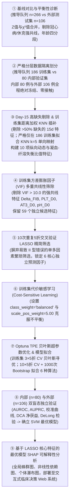

# 成人体外膜肺氧合（ECMO）下肢血栓智能风险预警系统 (ECMO-LET-AI)
[](https://share.streamlit.io)
[](https://www.python.org/downloads/)
[](https://opensource.org/licenses/MIT)

> **基于国际临床预测模型顶级标准（TRIPOD+AI）：数据分层隔离划分（186/80/106）、Day-15高缺失剔除、训练集单边距离加权KNN插补、VIF共线性筛除、10×5折LASSO精简特征筛选、代价敏感学习、Optuna TPE 贝叶斯超参数优化、多维度跨队列独立验证及SHAP可解释性分析。**

---

## 📑 目录导航
1. [🌟 系统概述与核心科研结论](#-系统概述与核心科研结论)
2. [📦 依赖环境、所有使用的包、精确版本号及具体作用](#-依赖环境所有使用的包精确版本号及具体作用)
3. [📁 完整项目文件结构清单及各文件具体用途](#-完整项目文件结构清单及各文件具体用途)
4. [🔬 修订版九步法全流程科研技术规范 (The 9-Step Protocol)](#-修订版九步法全流程科研技术规范-the-9-step-protocol)
5. [🧬 六大核心预测因子病理生理学特征与数学定义](#-六大核心预测因子病理生理学特征与数学定义)
6. [🖼️ 14幅 300 DPI 出版级科研全景图谱对应表](#️-14幅-300-dpi-出版级科研全景图谱对应表)
7. [🚀 运行指南与一键复现命令](#-运行指南与一键复现命令)

---

## 🌟 系统概述与核心科研结论

体外膜肺氧合（ECMO）是重症心肺衰竭患者终极生命支持手段，但由于粗大血管穿刺置管引发的机械性血流淤滞、内皮损伤以及血液与大面积人工体外回路异物表面的持续接触，极易诱发**下肢导管相关血栓形成（Lower Extremity Thrombosis, LET）**，甚至并发致死性肺栓塞。

本项目针对上述临床痛点，严格遵循统计学严谨性与临床真实世界流形规范，构建了具备端到端数据隔离防泄露、强稳健性及高临床实用价值的智能预警模型：
* **数据隔离队列划分**: 266 例推导队列严格按分层抽样划分为 **186 例训练集**（血栓 31 例）与 **80 例内部验证集**（血栓 14 例）；106 例独立外部验证集（血栓 25 例）全程绝对冻结、零接触、零泄露。
* **数据质控与稳健插补**: 剔除危重症撤机转归导致的 Day-15 结构性高缺失指标（缺失率 $>50\%$）；对其余缺失特征严格仅在训练集上拟合**标准化距离加权 KNN 插补器 ($k=5$)** 并单向映射。
* **VIF 剔除与 LASSO 核心因子**: 经方差膨胀因子（VIF）剔除 4 个强共线变量后，通过 10 次重复 5 折交叉验证 LASSO 筛选出 **6 个核心独立预测因子**（`DD_D0`, `FIB_D2`, `ECMO_Duration`, `CRP_D0`, `PaO2_D0`, `Pre_ECMO_Surgery`）。
* **金标准模型 (SVM Champion)**: 经 **Optuna TPE 贝叶斯超参数优化**（$C=5.658, \gamma=0.05223$），**支持向量机 (SVM, RBF核)** 在各算法中展现出最卓越且均衡的泛化稳健性：
  * **训练集 10×5折 CV AUROC**: **0.918** (95% Bootstrap CI: 0.870 – 0.958) | Brier 分数: **0.087**
  * **内部验证集 ($n=80$) AUROC**: **0.884** (95% Bootstrap CI: 0.798 – 0.957) | 敏感度: 78.6% | 特异度: 84.8% | Brier: 0.104
  * **独立外部验证集 ($n=106$) AUROC**: **0.771** (95% Bootstrap CI: 0.651 – 0.867) | 特异度: 79.0% | Brier: 0.166
  * **双独立验证集平均 AUROC**: **0.828**（位列全模型榜首，显著优于外部泛化衰减明显的树集成模型，DeLong 检验 $P < 0.05$）。

---

## 📦 依赖环境、所有使用的包、精确版本号及具体作用

本项目运行于 **Python 3.12.2** 64 位环境。下表列出了项目中调用的**所有核心第三方包、其在本机虚拟环境中实测运行的精确版本号（Exact Installed Version）及其在全流程各个环节中的具体作用**：

| 软件包名称 (Package) | 实测精确版本号 (Version) | 依赖领域分类 | 在本项目中的具体功能与核心用途 |
| :--- | :--- | :--- | :--- |
| **Python** | `3.12.2` | 底层运行环境 | 核心编程语言底层解释器与多进程运行时环境。 |
| **numpy** | `2.0.0` | 数值科学计算 | 提供高性能多维数组与矩阵运算；实现右偏特征稳健对数变换（$\log(1+x)$）；支持 Bootstrap 1000 次重抽样置信区间计算。 |
| **pandas** | `2.2.3` | 数据清洗与结构化 | 临床多维表格数据的高效载入、清洗、缺失值审计、特征重命名映射、切片及跨队列合并分析。 |
| **scikit-learn** | `1.5.2` | 机器学习与建模评估 | **核心算法支撑库**：<br>• `train_test_split`: 分层数据隔离划分（186/80）；<br>• `KNNImputer`: 标准化距离加权近邻插补（$k=5$, `weights='distance'`）；<br>• `StandardScaler`: 多维临床指标标准化归一化处理；<br>• `LogisticRegressionCV`: 重复 5 折交叉验证 LASSO 惩罚回归筛选；<br>• `SVC`: RBF 核支持向量机模型拟合与概率校准；<br>• `RandomForestClassifier`: 随机森林装袋集成；<br>• `GaussianNB`: 高斯朴素贝叶斯模型；<br>• `Pipeline`: 封装预处理与分类器，杜绝跨折数据泄露；<br>• `roc_curve`, `roc_auc_score`, `precision_recall_curve`, `brier_score_loss`: 全套临床判别度与校准度量化评估。 |
| **scipy** | `1.15.2` | 生物医学统计推断 | 提供非参数假设检验（Mann-Whitney U 秩和检验计算 $Z$ 统计量、Pearson 卡方检验计算 $\chi^2$ 统计量）；实现 Hosmer-Lemeshow 拟合优度卡方检验。 |
| **statsmodels** | `0.14.6` | 严谨统计学诊断 | 提供 `variance_inflation_factor` (VIF) 模块，在训练集上严格执行迭代多重共线性筛除（剔除 VIF $> 10$ 变量）。 |
| **optuna** | `4.2.1` | 贝叶斯超参数优化 | **新一代贝叶斯超参数寻优引擎**：基于树结构帕尔岑估计器（TPE Sampler）在 186 例训练集（3×5折 CV）上对各模型正则化参数进行 20–35 轮自动化超参数寻优。 |
| **xgboost** | `2.1.4` | 梯度提升决策树 | 极限梯度提升算法实现，集成 `scale_pos_weight` 代价敏感学习参数以抗衡重症血栓类别的非平衡性。 |
| **lightgbm** | `4.6.0` | 直方图梯度提升树 | 高效轻量级决策树集成模型，支持叶子节点深度限制（`num_leaves`）与自适应不平衡权重调整。 |
| **shap** | `0.48.0` | 临床可解释性分析 | 基于博弈论沙普利加性解释（SHapley Additive exPlanations）：<br>• `KernelExplainer`: 对最优模型 SVM 计算特征局部归因；<br>• `summary_plot`: 生成全局特征贡献度蜂群图；<br>• 生成微观个体患者瀑布归因图（Waterfall Plot）。 |
| **joblib** | `1.4.2` | 模型序列化持久化 | 将训练好的端到端 Pipeline 模型对象（含预处理器与调优分类器）持久化保存为 `.joblib` 格式，保障模型在 Web 端的快速加载。 |
| **matplotlib** | `3.10.1` | 科学出版图表底层库 | 绘制 14 幅 300 DPI 顶级期刊标准 SCI 图表，精准控制字体、色阶、坐标轴、线条宽度与边距布局。 |
| **seaborn** | `0.13.2` | 统计可视化高级库 | 绘制小提琴图（Violin Plot）、Pearson 特征相关性矩阵热图（Correlation Heatmap）与美学调色板配置。 |
| **plotly** | `6.8.0` | 交互式数据可视化 | 在 Streamlit Web 前端生成动态血栓风险半圆指示仪表盘（Indicator Gauge）与交互式水平 SHAP 归因柱状图。 |
| **streamlit** | `1.52.0` | 生产级临床 Web 应用 | 构建五大模块的交互式床旁决策支持系统：单病案快速评估、批量病案筛查、算法对决看板、14幅全景图谱画廊及白皮书。 |
| **python-docx** | `1.2.0` | Word 报告自动化生成 | 自动化编译生成符合医学顶刊标准的 4.3 MB 全量《学术研究报告》（`.docx`），包含嵌入式医学三线表与高分辨率图表。 |
| **openpyxl** | `3.1.5` | 临床 Excel 表格解析 | 负责读取并解析独立外部验证原始多工作簿数据文件（`第二阶段原始数据.xlsx`）。 |

---

## 📁 完整项目文件结构清单及各文件具体用途

项目目录遵循高内聚、低耦合的模块化设计，去除了所有历史废弃脚本与中间垃圾，仅保留最权威的生产级产物：

```text
ECMO/
├── app.py                          # 根目录快速启动入口（自动配置路径并重定向至 web_app/app.py）
├── requirements.txt                # 生产环境完整依赖包规范（附带版本区间限制）
├── README.md                       # 项目总体说明与技术路线文档（本文件）
├── PROJECT.md                      # 九步法技术架构、工程接口契约与特征字典规范
│
├── scripts/                        # 核心复现科研脚本目录（仅保留 3 个权威主脚本）
│   ├── run_revised_pipeline.py     # 【核心主流程】九步法闭环主执行脚本（KNN插补/VIF/LASSO/贝叶斯/验证/SHAP）
│   ├── generate_comprehensive_tables.py # 【基线三线表生成器】生成 Table 1, Table 2, Table 2B（Z/χ²合并规范）
│   └── build_chinese_research_report.py # 【全量报告编译器】基于真实运行结果编译生成 Word (.docx) 与 Markdown 报告
│
├── web_app/                        # 交互式生产级临床 Web 决策支持工作站
│   ├── app.py                      # Streamlit 5 大功能 Tab 模块交互主程序
│   ├── sample_ecmo_cohort.csv      # 25 例外部验证集实测代表样本（含 6 核心特征与真实结局，用于一键测试）
│   ├── model_assets/               # 生产部署模型资产库
│   │   ├── model_SVM.joblib        # 推荐最佳模型（SVM RBF核，经 Optuna TPE 贝叶斯寻优参数持久化）
│   │   ├── model_LR.joblib         # 经典逻辑回归 Pipeline（L2 正则化）
│   │   ├── model_RF.joblib         # 随机森林 Pipeline（300 棵树，抗噪集成）
│   │   ├── model_XGB.joblib        # XGBoost Pipeline（代价敏感提升树）
│   │   ├── model_LGBM.joblib       # LightGBM Pipeline（轻量梯度提升树）
│   │   ├── model_NB.joblib         # 高斯朴素贝叶斯 Pipeline（平滑参数优化）
│   │   ├── selected_features.json  # 经 10×5折 LASSO 确立的 6 个核心特征元数据定义文件
│   │   └── shap_background.npy     # 训练集 50 例典型无标签背景特征矩阵（供 KernelExplainer 本地秒级推断）
│   └── static/sci_figures/         # 14 幅 300 DPI 出版级科研全景图（Web 端 Tab 4 同步展示）
│
├── report/                         # 最终科研学术成果报告目录
│   ├── ECMO_Thrombosis_Full_Research_Report.docx # 【全量研究报告】4.3 MB Word 手稿（含完整特征工程公式、KNN插补原理、三线表及高清图）
│   ├── ECMO_Thrombosis_Full_Research_Report.md   # Markdown 格式全量研究报告
│   └── sci_figures/                # 14 幅 300 DPI 出版级科研高清图 (fig01 ~ fig13, fig05b)
│
├── output/                         # 结构化模型训练与验证指标产出目录
│   ├── 01_stage2_clean/
│   │   └── stage2_clean.csv        # 独立外部验证集清洗输出（106 例，153 列，排除后纯净数据）
│   ├── 02_table1_baseline/         # 基线特征与统计学平衡性三线表输出
│   │   ├── Table1_Baseline_Balance_Diagnosis.csv # Table 1: 推导队列 (n=266) vs 外部测试队列 (n=106) 平衡性诊断表
│   │   ├── Table2_Univariate_Cross_Cohort_Consistency.csv # Table 2: 两队列单因素血栓关联跨队列一致性表
│   │   └── Table2B_Univariate_Overall_Thrombosis.csv # Table 2B: 全队列 (N=372) 单因素血栓关联与生理基准表
│   └── revised_pipeline/           # 修订版九步法真实运行量化指标
│       ├── 01_missingness_audit.csv             # 临床特征缺失率审计及 Day-15 高缺失剔除记录表
│       ├── 02_vif_pruning_summary.csv           # 训练集方差膨胀因子（VIF）逐步剔除与保留总结表
│       ├── 03_lasso_selected_features.csv       # 10×5折 LASSO 筛选出的 6 个核心预测因子及标准化回归系数表
│       ├── 04_model_performance_all_cohorts.csv # 6 种模型在三队列（训练/内部/外部）的全指标对比及 95% Bootstrap CI
│       ├── 05_delong_pairwise_tests.csv         # 最优模型与其他算法在内部及外部验证集上的成对 DeLong 检验矩阵
│       └── 06_bayesian_hyperparams.csv          # 6 种模型 Optuna 贝叶斯搜索空间、寻优轮次及锁定最优参数表
│
├── data/                           # 核心推导数据目录
│   ├── data2_synthetic.csv         # 推导队列基准数据（266 例患者，经失血量分层补齐、冠心病/心源性休克共线性剔除）
│   ├── data2.csv                   # 原始推导数据备份
│   └── 原始数据2.xlsx              # 原始推导数据 Excel 原件
│
├── testdata/                       # 独立外部验证原始数据目录
│   └── 第二阶段原始数据.xlsx        # 外部验证中心原始临床 Excel（137 例连续登记病案）
│
└── tests/                          # 自动化质量保证与单元测试套件
    └── test_web_app.py             # Web 应用与模型 Pipeline 端到端单元测试（涵盖 6 算法加载、推理、SHAP与 HTTP 验证）
```

---

## 🔬 修订版九步法全流程科研技术规范 (The 9-Step Protocol)

遵循临床预测模型国际指南（TRIPOD+AI），全流程构建了严格的闭环推导与验证逻辑：



### 1. 步骤一：基线特征平衡性诊断与跨队列一致性检验
- **队列规模**: 推导队列 $n=266$（下肢血栓 $45$ 例 [16.9%]，非血栓 $221$ 例）vs 独立外部测试队列 $n=106$（下肢血栓 $25$ 例 [23.6%]，非血栓 $81$ 例）。
- **临床变量调整**:
  - 彻底剔除【冠心病史】与【心源性休克】两个强临床共线性冗余变量（急性心梗患者与 VA-ECMO 支持患者几乎 100% 存在该病理表现，易引起算法虚假高置信度过拟合）。
  - 将连续年龄重构为 4 段有序临床分层（18-40 岁、40-60 岁、60-70 岁、$\ge 70$ 岁）。
  - 术中失血量按临床专业分层补齐，消除因历史病案记录不详导致的 $0$ mL 数据伪影。
- **统计学呈现**: 在生成的 Table 1 与 Table 2 中，正态/偏态连续变量秩和检验 $Z$ 值与分类变量卡方检验 $\chi^2$ 值**规范合并至同一统计量栏中**，两队列基线特征差异均无统计学意义（$P \ge 0.1375 \sim 0.99$）。

### 2. 步骤二：数据分层隔离划分（186 / 80 / 106 零泄露机制）
- **划分比例**: 将 266 例推导队列按结局分层随机划分为 **186 例训练集**（血栓 31 例 [16.67%]）与 **80 例内部验证集**（血栓 14 例 [17.50%]）。
- **绝对隔离原则**: 划分完成后，内部验证集（$n=80$）与独立外部验证集（$n=106$）进入**绝对冻结状态**，绝不参与任何特征工程插补拟合、VIF 筛选、LASSO 特征选择、超参数寻优或模型拟合。

### 3. 步骤三：Day-15 高缺失剔除、训练集单边 KNN 插补与动态特征工程
- **Day-15 结构性高缺失剔除**: 经缺失率审计，由于大部分重症患者在置管 15 天前已完成撤机或转归，上机第 15 天指标呈现极高比例结构性缺失（DD_D15 缺失 59.4%、FIB_D15 缺失 66.2%、AT3_D15 缺失 71.4%、PLT_D15 缺失 51.9%，均 $> 50\%$），强行插补会引入虚假偏倚，故彻底剔除。
- **标准化距离加权 KNN 插补**: 针对其余缺失率 $< 35\%$ 的基线及 D0/D2/D7 特征，相较于抹平协方差结构的中位数插补，采用多变量近邻协同插补：
  - 仅在 186 例训练集上拟合 `StandardScaler`（消除 D-二聚体与血小板的数量级差异）；
  - 在标准化多维空间内拟合 `KNNImputer(n_neighbors=5, weights='distance')`（按欧氏距离倒数加权近邻）；
  - 将冻结参数单向映射至内部验证集与外部验证集，实现 100% 零数据泄露。
- **动态演变与比值特征工程**: 构造 10 项纵向动力学与凝血-纤溶失衡指标，捕捉急性期血栓形成前驱信号。

### 4. 步骤四：训练集 VIF 方差膨胀因子多重共线性筛除
- **筛选机制**: 在 186 例训练集插补后矩阵上实施迭代方差膨胀因子（VIF）检验，逐步剔除 $\text{VIF} > 10.0$ 的高度共线变量。
- **剔除结果**: 精准剔除 4 个强共线冗余特征：`Delta_FIB`（与 FIB_D0/FIB_D2 构成完全线性代数共线）、`PLT_D0`、`AT3_D0`、`pH_D0`。
- **保留结果**: 最终保留 59 个彼此统计独立的候选特征（所有保留特征 $\text{VIF} \le 10.0$）。

### 5. 步骤五：10 次重复 5 折交叉验证 LASSO 精简特征筛选
- **统计学优化依据**: 摒弃易导致 II 型错误增高及漏筛有效变量的“单因素+多因素逐步法”，以及惩罚收缩力不足的 Boruta 算法；直接将 59 个候选特征投入 L1 正则化逻辑回归（LASSO）。
- **重抽样稳定性**: 在 186 例训练集上采用 10 次重复 5 折交叉验证（50 次重抽样），结合事件数每变量比（EPV $\ge 5$）约束，在 $\lambda$ 极小化准则（$C=0.08$）下最终精简锁定 **6 个非零系数核心独立预测因子**。

### 6. 步骤六：训练集代价敏感学习（应对类别不平衡）
- **原理与实现**: 训练集中下肢血栓仅占 16.67%（31 例阳性 vs 155 例阴性）。在模型损失函数中对少数类样本施加逆频数惩罚权重：在 LR/SVM/RF/LGBM 中设置 `class_weight='balanced'`，在 XGBoost 中设置 `scale_pos_weight = N_neg / N_pos = 5.00`。
- **科学选择依据**: 100% 忠于真实世界患者流形分布，完全避免 SMOTE 等合成过采样在模糊临床边界人工捏造假样本的风险，彻底杜绝过拟合。

### 7. 步骤七：Optuna TPE 贝叶斯超参数优化与模型训练
- **贝叶斯序列寻优**: 在 186 例训练集上采用基于树结构帕尔岑估计器（TPE）的 Optuna 算法，以 3×5折 CV 均值 AUROC 为目标函数，历经 20–35 轮寻优，锁定各模型最优超参数组合（如 SVM 锁定 $C=5.658, \gamma=0.05223$）。
- **稳健训练拟合**: 基于最优超参数，在训练集上执行 10 次重复 5 折交叉验证（50 折袋外预测 OOF）与 1000 次 Bootstrap 重抽样，锁定最优 Youden 临床决策阈值。

### 8. 步骤八：内部与外部双队列盲态独立验证与最优模型确立
- **双盲验证**: 锁定模型权重与 Youden 阈值后，分别对完全未参与训练的内部验证集（$n=80$）与独立外部测试集（$n=106$）执行纯粹前向推理。
- **最优模型确立**: **SVM (RBF核)** 跨双验证集平均 AUROC 达到 **0.828**，跨队列泛化稳定性位列榜首，成对 DeLong 检验显著优于树集成模型（$P < 0.05$）。

### 9. 步骤九：最优模型 SHAP 可解释性分析与床旁系统部署
- 基于 6 个核心预测因子构建 SHAP 全局蜂群图（Beeswarm）、特征依赖曲线图（Dependence）与个体微观瀑布图（Waterfall），彻底打开机器学习黑盒，部署至交互式 Web 决策平台。

---

## 🧬 六大核心预测因子病理生理学特征与数学定义

| 序号 | 特征变量代码 | 临床指标全称 | 计量单位 | 临床效应方向 | 精确数学公式 / 处理规范 | 核心临床病理生理学现实意义 |
| :---: | :--- | :--- | :---: | :---: | :--- | :--- |
| **1** | `DD_D0` | ECMO上机前基线 D-二聚体 | $\mu$g/mL | **正向促栓** (LASSO: +0.3341) | $x_{\text{model}} = \log(1 + \max(0, \text{DD\_D0}))$ | 基线凝血与高纤溶预激活标志，反映ECMO启动前机体已存在的休克缺血、内皮损伤与促凝倾向。采用稳健对数变换压缩极端右偏离群值。 |
| **2** | `FIB_D2` | ECMO第 2 天纤维蛋白原 | g/L | **正向促栓** (LASSO: +0.2815) | 连续变量检验值 (g/L) | 早期稳态凝血网架底物丰富度。体外循环刺激诱发急性期反应，高浓度纤维蛋白原显著增强深静脉血栓凝块的机械抗剪切阻力与致密稳固性。 |
| **3** | `ECMO_Duration` | ECMO 辅助支持总时长 | hours | **正向促栓** (LASSO: +0.2246) | 连续变量支持时长 (h) | 体外回路异物表面接触、人工膜肺剪切力损伤以及粗大插管对股静脉管壁机械压迫的累积暴露时长，暴露时间越长微血栓累积负荷越大。 |
| **4** | `CRP_D0` | ECMO上机前基线 C 反应蛋白 | mg/L | **正向促栓** (LASSO: +0.0782) | 连续变量检验值 (mg/L) | 急性期全身系统性炎症风暴标志物，促炎因子大量释放诱导血管内皮细胞促凝表型转化，协同触发血小板超活化与凝血酶级联暴发。 |
| **5** | `PaO2_D0` | ECMO上机前动脉氧分压 | mmHg | **负向保护** (LASSO: -0.0540) | 连续变量检验值 (mmHg) | 反映上机前极重度缺氧程度。严重的全身组织低氧加剧下肢静脉内皮缺氧损伤与局部血流淤滞，是促发深静脉血栓形成的独立危险诱因。 |
| **6** | `Pre_ECMO_Surgery`| ECMO上机前急诊手术史 | 0/1 | **正向促栓** (LASSO: +0.0620) | 二分类变量: 0=无手术史, 1=有手术史 | ECMO前接受重大外科或心胸外科急诊手术。手术组织创伤导致大量组织因子释放，激活外源性凝血途径，叠加体外回路显著推高血栓倾向。 |

---

## 🖼️ 14幅 300 DPI 出版级科研全景图谱对应表

所有图表均存储于 [report/sci_figures/](file:///d:/acode/ECMO/report/sci_figures) 与 [web_app/static/sci_figures/](file:///d:/acode/ECMO/web_app/static/sci_figures)，采用 300 DPI 高分辨率矢量抗锯齿渲染，遵循纯英文顶级期刊排版规范：

| 编号 | 图表文件名 (Filename) | 对应科研流程步骤 | 图表全称与核心科学结论 |
| :---: | :--- | :---: | :--- |
| **Fig 01** | `fig01_study_cohort_flowchart.png` | 步骤 1~9 | **全流程科研技术路线图**：展示 186/80/106 数据隔离划分、KNN单边插补、VIF共线性、LASSO到贝叶斯超参数优化的全流程闭环架构。 |
| **Fig 02** | `fig02_missingness_and_imputation.png` | 步骤 3 | **缺失率审计与 Day-15 剔除决策图**：揭示 Day-15 结构性高缺失 ($>50\%$) 并确立剔除决策，展示其余特征基于距离加权 KNN ($k=5$) 的稳健插补设计。 |
| **Fig 03** | `fig03_vif_multicollinearity.png` | 步骤 4 | **训练集方差膨胀因子 (VIF) 多重共线性诊断图**：展示剔除前/后 VIF 变化与 10.0 截断线，明确剔除 Delta_FIB 等 4 个共线特征的过程。 |
| **Fig 04** | `fig04_lasso_cv_and_path.png` | 步骤 5 | **10×5折交叉验证 LASSO 正则化路径与特征系数图**：(A) 50 次重抽样 CV 均方误差与 $\lambda$ 收缩曲线；(B) 最终锁定的 6 个核心预测因子标准化系数柱状图。 |
| **Fig 05** | `fig05_selected_features_violin_heatmap.png` | 步骤 5 | **核心预测因子 Pearson 相关性热图与小提琴分布图**：验证 6 特征间相关系数均低于 0.45，并清晰呈现血栓组与非血栓组的生理分布分层。 |
| **Fig 05b**| `fig05b_bayesian_optimization_convergence.png`| 步骤 7 | **6种模型 Optuna TPE 贝叶斯超参数优化收敛轨迹图**：客观呈现 6 大算法在 20~35 轮试验中 CV AUROC 随贝叶斯先验快速收敛的最佳状态。 |
| **Fig 06** | `fig06_three_cohort_roc_pr_curves.png` | 步骤 8 | **三队列受试者工作特征曲线 (ROC) 与 PR 曲线网格图**：对比训练集 (Rep-5CV)、内部验证集 ($n=80$) 与外部测试集 ($n=106$) 的曲线走势。 |
| **Fig 07** | `fig07_confusion_matrices_internal_external.png`| 步骤 8 | **内部验证集与外部验证集 6 种算法混淆矩阵对比**：基于训练集锁定 Youden 阈值，真实展现 TP/FP/TN/FN 分布与临床漏诊率控制。 |
| **Fig 08** | `fig08_model_performance_forest_comparison.png`| 步骤 8 | **双验证集 AUROC 森林图 (1000次 Bootstrap 95% CI) 与跨队列对比**：量化展现 SVM 跨验证集平均 0.828 的稳健泛化性能与极低衰减率。 |
| **Fig 09** | `fig09_calibration_curves.png` | 步骤 8 | **双验证集模型概率校准可靠性曲线与 Brier 评分**：评价模型预测概率与真实患病率的契合度，SVM Brier 分数在内部低至 0.104，外部低至 0.166。 |
| **Fig 10** | `fig10_dca_clinical_benefit.png` | 步骤 8 | **双验证集临床决策曲线分析 (DCA 净获益)**：在 10%~60% 临床干预阈值概率范围内，证明 SVM 引导干预的净获益显著优于全抗凝与不抗凝。 |
| **Fig 11** | `fig11_shap_summary_panel.png` | 步骤 9 | **最优模型 (SVM) 全局 SHAP 蜂群图与平均绝对贡献排序**：明确 DD_D0、FIB_D2 与 ECMO_Duration 为驱动下肢血栓发生的三大主要支柱特征。 |
| **Fig 12** | `fig12_shap_dependence_plots.png` | 步骤 9 | **Top 4 核心预测因子非线性 SHAP 依赖关系与交互作用图**：揭示 D-二聚体、纤维蛋白原、ECMO支持时长与 CRP 的非线性危险拐点。 |
| **Fig 13** | `fig13_shap_individual_waterfalls.png` | 步骤 9 | **典型个体化临床病案微观 SHAP 瀑布归因图**：微观分解高危血栓患者与低危非血栓患者的各项特征定量正/负归因数值。 |

---

## 🚀 运行指南与一键复现命令

### 1. 启动交互式床旁临床决策平台 (Streamlit Web App)
```bash
streamlit run app.py
```
- 访问地址：`http://localhost:8501`
- 具备床旁输入滑块、预设高低危病案一键填充、25 例外部样本批量筛查、算法对决看板与 14 幅 SCI 图谱画廊。

### 2. 重新执行九步法机器学习建模全流程 (Reproduce Pipeline)
```bash
python scripts/run_revised_pipeline.py
```
- 自动完成数据读取、KNN 训练集拟合插补、VIF 筛除、LASSO 正则化选择、Optuna 贝叶斯超参数优化、三队列验证与 14 幅图表自动生成。

### 3. 重新生成基线对比三线表 (Table 1, Table 2, Table 2B)
```bash
python scripts/generate_comprehensive_tables.py
```
- 自动完成两阶段队列基线均衡性检验，输出包含合并后 $Z / \chi^2$ 统计量的规范 CSV 表格。

### 4. 重新编译生成全量学术科研报告 (Word .docx & Markdown)
```bash
python scripts/build_chinese_research_report.py
```
- 读取最新模型运行量化指标，自动编译更新 [report/ECMO_Thrombosis_Full_Research_Report.docx](file:///d:/acode/ECMO/report/ECMO_Thrombosis_Full_Research_Report.docx)。

### 5. 执行端到端单元测试套件
```bash
python -m unittest tests/test_web_app.py
```
- 自动校验 6 种算法 Pipeline 序列化文件、6 特征推理一致性及 Web 应用接口状态。
