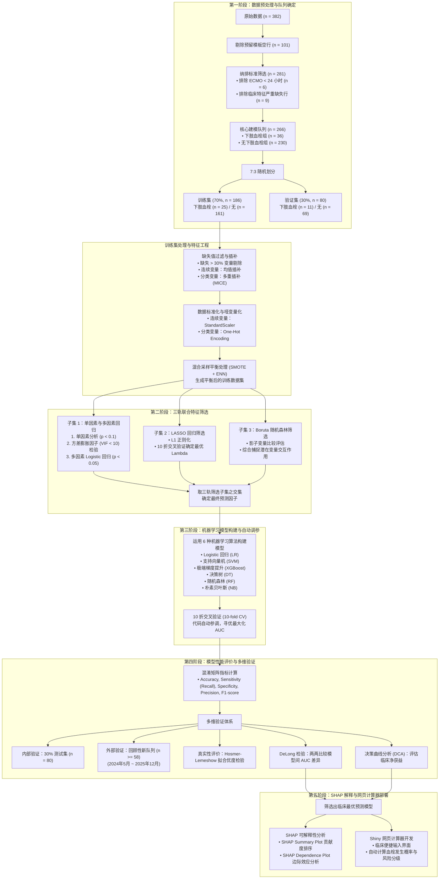

# ECMO 支持患者下肢血栓预测模型 - 项目实施与技术路线方案

本项目旨在基于 6 种机器学习算法，构建 ECMO 支持患者下肢血栓（Lower Extremity Thrombosis, LET）形成风险的预测模型，并进行内外部验证、SHAP 临床可解释性分析以及 R Shiny 网页计算器的开发。

---

## 1. 技术路线图 (Technical Pipeline)

下面是该项目从原始数据处理到网页端计算器部署的完整学术级技术路线图：

---

## 2. 详细实施步骤与技术规范

### 2.1 第一阶段：数据清洗与纳排筛选
1. **数据切片**：
   - 过滤无意义行：仅提取索引 `[0:265]` 的 266 例患者作为核心研究队列。
   - 定义靶点事件：对 `血栓事件` 字段中含有“下肢、股、大隐、髂、足”字样的样本标记为下肢血栓患者（`LET = 1`），共 36 例；其余标为无下肢血栓（`LET = 0`），共 230 例。
2. **缺失值处理（缺失 > 30% 变量过滤）**：
   - 从数据基本检查报告中可见，`CRP` (56.02%)，`CRP.1` (57.89%)，`CRP.2` (63.91%)，以及上机第 15 天的大部分检查结果（`FIB.4` (66.17%), `APTT.4` (66.54%) 等）缺失率均超过 30%，应当在预处理阶段予以剔除。
   - 对缺失率 $\le 30\%$ 的特征：
     - **连续变量**（如生理指标）：采用均值（Mean）或中位数（Median）填充。
     - **分类变量**：采用 R 语言 `mice` 包中的多重插补逻辑回归法（Multivariate Imputation by Chained Equations, MICE）进行填充。
3. **数据转化与集划分**：
   - **连续变量标准化**：使用 Python 中的 `StandardScaler` 或 R 中的 `scale` 函数，将连续特征进行标准化，使其均值为 0，标准差为 1。
   - **分类变量哑变量化**：将多分类变量（如居住地、首要诊断等）转化为哑变量（Dummy variables/One-hot encoding），提高模型稳定度。
   - **划分数据集**：按 `7:3` 比例将 266 例样本随机拆分为训练集（`n = 186`）与验证集（`n = 80`）。

### 2.2 第二阶段：不平衡数据集平衡处理 (SMOTE + ENN)
由于下肢血栓阳性患者仅占 **13.53%**（36 例，训练集中约 25 例），存在明显的类不平衡（Class Imbalance）。直接训练会导致模型倾向于预测阴性。
- **混合采样法**：
  1. **SMOTE** (Synthetic Minority Over-sampling Technique)：在少数类（下肢血栓组）样本间通过 $k$ 近邻进行线性插值，合成新的少数类样本，避免单纯过采样导致的过拟合。
  2. **ENN** (Edited Nearest Neighbors)：通过 $k$ 近邻规则检查合成样本，若某样本与其最近的 $k$ 个邻居的类别不同，则将其清除，去除过度重叠产生的噪声，使分类边界更清晰。
- **规范**：SMOTE+ENN **仅在训练集上运行**，验证集和测试集必须保持最真实的分布，以客观评估模型泛化能力。

### 2.3 第三阶段：三轨特征筛选（最终预测因子的确定）
为兼顾传统医学统计学与先进机器学习特征工程的优势，采用三轨交叉检验：

1. **第一轨：医学统计筛选（子集 1）**：
   - 进行单因素分析（正态分布计量资料采用两独立样本 $t$ 检验，非正态采用 Wilcoxon 秩和检验，计数资料采用卡方检验/Fisher 精确概率法），筛选出 $P < 0.1$ 的变量。
   - 对初筛特征计算**方差膨胀因子（VIF）**，若 $VIF > 10$，提示存在严重多重共线性，剔除该特征。
   - 将通过 VIF 检验的变量纳入多因素 Logistic 回归分析，以 $P < 0.05$ 为标准，筛选出独立危险因素，组成**预测因子子集 1**。
2. **第二轨：LASSO 回归筛选（子集 2）**：
   - 使用 L1 正则化对所有特征进行惩罚，通过 10 折交叉验证（10-fold CV）选取使得偏差最小或一倍标准差范围内的最优惩罚系数 $\lambda$（$\lambda_{min}$ 或 $\lambda_{1se}$）。将系数非零的特征保留，组成**预测因子子集 2**。
3. **第三轨：Boruta 算法筛选（子集 3）**：
   - 基于随机森林算法，为每个特征创建打乱的“影子特征”（Shadow Features），计算其重要性基准线。通过多次迭代，只有重要性显著高于影子特征的变量才被确认为重要变量，组成**预测因子子集 3**。
4. **交集融合**：
   - $\text{最终预测因子} = \text{子集 1} \cap \text{子集 2} \cap \text{子集 3}$。

### 2.4 第四阶段：多算法模型构建与 10 折交叉验证调优
基于筛选出的最终预测因子，在 R 软件中选用以下 6 种经典机器学习算法：
- **逻辑回归 (LR)**：使用 `glm` 包，作为经典医学基准模型。
- **支持向量机 (SVM)**：使用 `e1071` 包，采用径向基核函数 (RBF kernel)。
- **随机森林 (RF)**：使用 `randomForest` 包，调整树的数量（`ntree`）和分裂节点特征数（`mtry`）。
- **决策树 (DT)**：使用 `rpart` 包，调整复杂度参数（`cp`）进行剪枝。
- **极端梯度提升 (XGBoost)**：使用 `xgboost` 包，调优学习率（`eta`）、最大深度（`max_depth`）和子样本比例（`subsample`）。
- **朴素贝叶斯 (NB)**：使用 `naivebayes` 包。

**超参数调优**：
使用训练集数据实施 10 折交叉验证。在每一折中，通过网格搜索（Grid Search）或贝叶斯优化（Bayesian Optimization）自动调整各模型的超参数组合，寻优使平均 AUC（Area Under Curve）值最大的最佳参数集。

### 2.5 第五阶段：模型评价与内外部验证
1. **内部验证**：
   - 将划分出的 30% 验证集数据（n = 80）代入 6 个模型，计算混淆矩阵指标：
     - **准确率 (Accuracy)**
     - **召回率 (Recall / Sensitivity)**：对于识别血栓高风险尤为关键，避免漏诊。
     - **特异性 (Specificity)**
     - **精确率 (Precision)**
     - **F1 分数 (F1-Score)**
2. **外部验证**：
   - 收集 2024 年 5 月 ~ 2025 年 12 月的新队列患者（验证样本不少于 58 例），对 6 种模型进行独立外部验证，评价模型的泛化性能。
3. **模型真实性与优越性比较**：
   - **Hosmer-Lemeshow 拟合优度检验**：评估模型的校准度（Calibration），检验预测概率与实际发生率的一致性（$P > 0.05$ 表示拟合优度良好）。
   - **DeLong 检验**：对 6 种模型的 ROC 曲线下面积（AUC）进行两两显著性差异检验，筛选出表现最优秀的模型。
   - **DCA 决策曲线分析**：绘制决策曲线，以横坐标阈值概率（Threshold Probability）与纵坐标净获益值（Net Benefit）评估模型在临床实际决策中的实用价值。

### 2.6 第六阶段：最优模型 SHAP 可解释性分析
传统机器学习由于其复杂结构常被称为“黑箱”。本研究利用 SHAP (SHapley Additive exPlanations) 算法进行最优模型的归因分析，提高临床可信度：
1. **SHAP 汇总图 (SHAP Summary Plot)**：展示各个特征对下肢血栓预测的整体贡献度排序（全局重要性），以及每个特征取值大小与风险的关联方向。
2. **SHAP 依赖图 (SHAP Dependence Plot)**：分析特定特征（如 D-二聚体、ECMO 支持时长）对模型预测输出的边际效应，展示非线性变化趋势及特征间的交互作用。

### 2.7 第七阶段：网页端临床计算器开发 (R Shiny Deployment)
利用 RStudio 软件中的 `shiny` 框架开发交互式网页计算器：
- **前端 UI 设计**：
  - 左侧为患者临床参数输入面板（包含筛选出的最终预测因子，支持滑块选择连续数值，下拉框选择分类变量）。
  - 右侧为计算结果展示区（包含血栓发生概率进度条、风险分级建议、以及个体化 SHAP 解释瀑布图）。
- **后端 Server 逻辑**：
  - 调用保存的最佳模型文件，实时接收前端输入并计算预测概率。
  - 自动渲染 SHAP 单个样本力导向图（Force Plot），向医生直观展示该患者各项指标对其风险评分的加分/减分贡献。

---

## 3. R 语言环境准备与核心代码包清单

为实现上述流程，R 语言环境（D:\R-4.5.0\bin）需安装并配置以下核心依赖包：

| 模块 | R 包名称 | 用途描述 |
|---|---|---|
| **数据读取与清洗** | `openxlsx`, `readxl`, `tidyverse` | 读取 Excel 原始文件，处理和格式化数据流 |
| **缺失值插补** | `mice` | 分类变量多重插补逻辑回归法 |
| **类不平衡处理** | `ROSE`, `DMwR2`, `themis` | 实现 SMOTE 算法；`recipes` / `tidymodels` 工具链支持 ENN 降噪 |
| **特征筛选** | `glmnet`, `Boruta`, `car` | VIF 计算 (`car`)；LASSO 模型拟合 (`glmnet`)；随机森林筛选 (`Boruta`) |
| **模型构建** | `rpart`, `randomForest`, `xgboost`, `naivebayes`, `e1071` | 构建决策树、随机森林、XGBoost、朴素贝叶斯和支持向量机模型 |
| **模型评价** | `pROC`, `ResourceSelection`, `dcurves` | `pROC` 绘制 ROC 曲线与 DeLong 检验；`ResourceSelection` 行 HL 检验；`dcurves` 进行 DCA 分析 |
| **模型解释** | `fastshap`, `shapr`, `ggplot2` | 计算并可视化 SHAP 属性值 |
| **网页部署** | `shiny`, `shinydashboard` | 开发和部署交互式网页版下肢血栓临床预测器 |
