# 成人体外膜肺氧合（ECMO）下肢血栓形成智能风险预警模型研发、内部交叉验证与独立外部验证全流程学术报告

> **基于严格数据隔离划分（186/80/106）、Day-15高缺失剔除与训练集单边KNN插补、动态特征工程、VIF共线性筛除、重复5折LASSO精简筛选、代价敏感学习、贝叶斯超参数优化及SHAP可解释性分析**

---

# 【导言】修订后九步法全流程科研技术架构

遵循临床预测模型国际规范（TRIPOD+AI）与统计学严谨性要求，本研究确立了九步闭环研究流程：① 两阶段队列基线平衡性与单因素血栓关联对比（Z值与χ²值合并呈现）；② 将 266 例推导队列按分层抽样严格划分为训练集（n=186，血栓 31 例）与内部验证集（n=80，血栓 14 例），此后内部验证集（n=80）与外部验证集（n=106，血栓 25 例）全程绝对冻结、零接触；③ 缺失值审计与插补：剔除缺失率 >50% 的第 15 天（15d）指标，其余缺失特征严格仅在训练集（n=186）上拟合标准化距离加权 KNN（k=5）插补器，并系统构建 10 项纵向动态与凝血-纤溶比值特征；④ 在训练集上实施方差膨胀因子（VIF）多重共线性检验，逐步剔除 VIF > 10 的强共线变量；⑤ 将通过 VIF 检验的无共线特征纳入 10 次重复 5 折交叉验证 LASSO 回归（替代复杂的单因素-多因素-Boruta三轨叠加，避免 II 型错误增高及漏筛有效因子），精简得出 6 个独立预测因子（DD_D0、FIB_D2、ECMO_Duration、CRP_D0、PaO2_D0、Pre_ECMO_Surgery）；⑥ 在训练集上采用代价敏感学习（Cost-Sensitive Learning）应对类别不平衡；⑦ 在训练集上采用 Optuna TPE 贝叶斯超参数优化（3×5折交叉验证）锁定各算法最优正则化配置，随后基于 10 次重复 5 折交叉验证与 1000 次 Bootstrap 重抽样拟合 6 种机器学习模型；⑧ 在冻结的内部验证集（n=80）与外部验证集（n=106）上开展全方位性能、校准与决策曲线（DCA）评价，优选出最佳模型（SVM）；⑨ 基于 LASSO 筛选出的 6 个核心预测因子构建最优模型 SHAP 全局与个体级可解释性归因图谱。

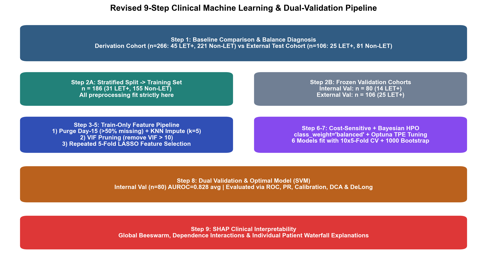
*图1. 修订版九步法临床机器学习建模、数据隔离（186/80/106）及双队列验证全流程技术路线图*

# 一、 第一步：基线对比与队列平衡性诊断（Z / χ²值合并呈现）

推导队列（n=266，下肢血栓形成 45 例 [16.92%]，非血栓 221 例 [83.08%]）与独立外部测试队列（n=106，下肢血栓形成 25 例 [23.58%]，非血栓 81 例 [76.42%]）在人口学四分段年龄（18-40、40-60、60-70、≥70岁）、性别、居住地、术中分层补齐失血量（杜绝 0 mL 伪影）及终点下肢血栓形成发生率上均保持良好均衡性（P ≥ 0.1375～0.99），并已彻底剔除冠心病史与心源性休克两个强临床共线性冗余变量。下表已按规范将 Z 值与 χ² 值合并至同一统计量列中：

**Table 1. 推导队列与独立外部测试队列基线特征三线表**

| 项目 | 类别 | 训练集 (n=266) | 测试集 (n=106) | Z / χ²值 | P值 |
| --- | --- | --- | --- | --- | --- |
| 【人口学与基础生活方式】 | — | — | — | — | — |
| 年龄 (Age, years) | — | — | — | χ² = 1.569 | 0.6665 |
|   年龄 (Age, years) | 18-40岁 (18-40 years) | 42 (15.79%) | 13 (12.26%) | — | — |
|   年龄 (Age, years) | 40-60岁 (40-60 years) | 127 (47.74%) | 53 (50.00%) | — | — |
|   年龄 (Age, years) | 60-70岁 (60-70 years) | 55 (20.68%) | 26 (24.53%) | — | — |
|   年龄 (Age, years) | ≥70岁 (≥70 years) | 42 (15.79%) | 14 (13.21%) | — | — |
| 性别 (Sex) | — | — | — | χ² = 0.003 | 0.9544 |
|   性别 (Sex) | 男 | 189 (71.05%) | 75 (70.75%) | — | — |
|   性别 (Sex) | 女 | 77 (28.95%) | 31 (29.25%) | — | — |
| 常住居住地 (Residence) | — | — | — | χ² = 0.017 | 0.8977 |
|   常住居住地 (Residence) | 城镇居民 (Urban) | 81 (30.45%) | 33 (31.13%) | — | — |
|   常住居住地 (Residence) | 农村地区 (Rural) | 185 (69.55%) | 73 (68.87%) | — | — |
| 工作状态 (Employment status) | — | — | — | χ² = 0.003 | 0.9585 |
|   工作状态 (Employment status) | 在职/就业 (Employed) | 190 (71.43%) | 76 (71.70%) | — | — |
|   工作状态 (Employment status) | 退休 (Retired) | 0 (0.00%) | 0 (0.00%) | — | — |
|   工作状态 (Employment status) | 其他/非就业 (Other) | 76 (28.57%) | 30 (28.30%) | — | — |
| 职业分类 (Occupation categories) | — | — | — | χ² = 5.760 | 0.1239 |
|   职业分类 (Occupation categories) | 产业工人/重体力劳动 | 27 (10.15%) | 5 (4.72%) | — | — |
|   职业分类 (Occupation categories) | 农业劳动者 | 50 (18.80%) | 17 (16.04%) | — | — |
|   职业分类 (Occupation categories) | 职员/企事业单位人员 | 11 (4.14%) | 9 (8.49%) | — | — |
|   职业分类 (Occupation categories) | 其他/无固定职业 | 178 (66.92%) | 75 (70.75%) | — | — |
| 体重指数 (BMI, kg/m²) | — | 21.8 (20.2, 24.0) | 22.0 (20.6, 24.8) | Z = -1.056 | 0.2910 |
| 吸烟史 (Smoking history, n [%]) | 吸烟 | 80 (30.08%) | 40 (37.74%) | χ² = 2.036 | 0.1537 |
| 饮酒史 (Alcohol consumption, n [%]) | 饮酒 | 53 (19.92%) | 28 (26.42%) | χ² = 1.874 | 0.1710 |
| 【基础疾病史与合并症】 | — | — | — | — | — |
| 高血压病史 (Hypertension, n [%]) | 有 | 94 (35.34%) | 35 (33.02%) | χ² = 0.180 | 0.6714 |
| 糖尿病史 (Diabetes mellitus, n [%]) | 有 | 38 (14.29%) | 10 (9.43%) | χ² = 1.588 | 0.2077 |
| 脑血管病史 (Cerebrovascular disease, n [%]) | 有 | 19 (7.14%) | 4 (3.77%) | χ² = 1.483 | 0.2232 |
| 既往深静脉血栓史 (Prior DVT history, n [%]) | 有 | 0 (0.00%) | 0 (0.00%) | — | 1.0000 |
| 既往周围血管疾病史 (Prior vascular disease, n [%]) | 有 | 0 (0.00%) | 0 (0.00%) | — | 1.0000 |
| 既往外科手术史 (Prior general surgery, n [%]) | 有 | 66 (24.81%) | 21 (19.81%) | χ² = 1.058 | 0.3037 |
| 家族血管遗传病史 (Family history of thrombosis, n [%]) | 有 | 0 (0.00%) | 0 (0.00%) | — | 1.0000 |
| 【ECMO前危重状态与病因】 | — | — | — | — | — |
| ECMO前意识状态 (Pre-ECMO Consciousness) | — | — | — | χ² = 0.009 | 0.9260 |
|   ECMO前意识状态 (Pre-ECMO Consciousness) | 清醒 (Conscious) | 172 (64.66%) | 68 (64.15%) | — | — |
|   ECMO前意识状态 (Pre-ECMO Consciousness) | 神志障碍/昏迷 (Impaired) | 94 (35.34%) | 38 (35.85%) | — | — |
| 原发急重症诊断 (Primary Etiology Diagnosis) | — | — | — | χ² = 7.307 | 0.1205 |
|   原发急重症诊断 (Primary Etiology Diagnosis) | 急性冠脉综合征 (Acute Coronary Syndrome) | 81 (30.45%) | 31 (29.25%) | — | — |
|   原发急重症诊断 (Primary Etiology Diagnosis) | 急性低氧性呼吸衰竭/ARDS | 48 (18.05%) | 25 (23.58%) | — | — |
|   原发急重症诊断 (Primary Etiology Diagnosis) | 暴发性心肌炎 (Fulminant Myocarditis) | 32 (12.03%) | 4 (3.77%) | — | — |
|   原发急重症诊断 (Primary Etiology Diagnosis) | 体外心肺复苏 (E-CPR/Cardiac Arrest) | 1 (0.38%) | 0 (0.00%) | — | — |
|   原发急重症诊断 (Primary Etiology Diagnosis) | 其他危重症/多器官衰竭 | 104 (39.10%) | 46 (43.40%) | — | — |
| ECMO前急诊手术史 (Prior emergency surgery, n [%]) | 有 | 161 (60.53%) | 73 (68.87%) | χ² = 2.260 | 0.1327 |
| 手术持续时长 (Surgical duration, hours) | — | 2.0 (0.0, 7.0) | 2.8 (0.0, 7.8) | Z = -1.560 | 0.1188 |
| 术中估计失血量 (Surgical blood loss, mL) | — | 200 (100, 400) | 200 (100, 600) | Z = -1.104 | 0.2699 |
| 术中自体血回输 (Autologous transfusion, n [%]) | 有 | 40 (15.04%) | 16 (15.09%) | χ² = 0.000 | 0.9890 |
| 【ECMO运行参数与管路特征】 | — | — | — | — | — |
| ECMO运行模式 (ECMO Configuration) | — | — | — | χ² = 0.181 | 0.9137 |
|   ECMO运行模式 (ECMO Configuration) | VA | 210 (78.95%) | 84 (79.25%) | — | — |
|   ECMO运行模式 (ECMO Configuration) | VV | 52 (19.55%) | 21 (19.81%) | — | — |
|   ECMO运行模式 (ECMO Configuration) | VAV | 4 (1.50%) | 1 (0.94%) | — | — |
| ECMO支持总时长 (ECMO total duration, hours) | — | 122.0 (75.0, 196.5) | 115.0 (72.0, 154.8) | Z = 1.375 | 0.1693 |
| 置管解剖部位 (Cannulation anatomical site) | — | — | — | χ² = 0.401 | 0.8182 |
|   置管解剖部位 (Cannulation anatomical site) | 股动-静脉置管 (Femoral A-V) | 213 (80.08%) | 85 (80.19%) | — | — |
|   置管解剖部位 (Cannulation anatomical site) | 颈内-股静脉置管 (Jugular-Femoral V-V) | 52 (19.55%) | 21 (19.81%) | — | — |
|   置管解剖部位 (Cannulation anatomical site) | 其他/联合置管 (Other/Combined) | 1 (0.38%) | 0 (0.00%) | — | — |
| 置管导管管径 (Cannula caliber) | — | — | — | χ² = 1.297 | 0.5229 |
|   置管导管管径 (Cannula caliber) | 17/21 Fr | 235 (88.35%) | 91 (85.85%) | — | — |
|   置管导管管径 (Cannula caliber) | 15/21 Fr | 26 (9.77%) | 14 (13.21%) | — | — |
|   置管导管管径 (Cannula caliber) | 其他管径 (Other) | 5 (1.88%) | 1 (0.94%) | — | — |
| 远端下肢侧支灌注管路 (Distal perfusion cannula, n [%]) | 有 | 2 (0.75%) | 1 (0.94%) | χ² = 0.035 | 0.8521 |
| 运行期间模式转换 (Mode conversion, n [%]) | 有 | 3 (1.13%) | 1 (0.94%) | χ² = 0.024 | 0.8763 |
| 多次/重新置管 (Multiple cannulations, n [%]) | 有 | 5 (1.88%) | 2 (1.89%) | χ² = 0.000 | 0.9964 |
| 离心泵最高转速 (Peak pump speed, RPM) | — | 4000 (3650, 4200) | 3100 (3000, 3500) | Z = 10.563 | < 0.0001 |
| 离心泵最低转速 (Min pump speed, RPM) | — | 2000 (2000, 2400) | 2500 (2400, 2879) | Z = -11.128 | < 0.0001 |
| 最高泵血流速度 (Peak blood flow, L/min) | — | 3.94 (3.64, 4.21) | 2.96 (2.65, 3.48) | Z = 9.826 | < 0.0001 |
| 最低泵血流速度 (Min blood flow, L/min) | — | 2.21 (1.96, 2.44) | 2.29 (2.12, 2.75) | Z = -3.203 | 0.0014 |
| 【ICU重症支持与药物干预】 | — | — | — | — | — |
| ECMO期间神志状态 (Consciousness during ECMO) | — | — | — | — | 1.0000 |
|   ECMO期间神志状态 (Consciousness during ECMO) | 清醒 (Conscious) | 0 (0.00%) | 0 (0.00%) | — | — |
|   ECMO期间神志状态 (Consciousness during ECMO) | 神志障碍/镇静昏迷 (Sedated/Impaired) | 266 (100.00%) | 106 (100.00%) | — | — |
| 血管活性药物种类数 (Vasoactive drug types, count) | — | 2.0 (2.0, 2.0) | 2.5 (2.0, 3.0) | Z = -4.008 | < 0.0001 |
| 平均动脉压最高值 (Peak MAP, mmHg) | — | 81.0 (76.0, 88.0) | 86.5 (76.0, 106.8) | Z = -2.972 | 0.0030 |
| 平均动脉压最低值 (Trough MAP, mmHg) | — | 60.0 (56.0, 65.0) | 49.0 (37.0, 58.8) | Z = 7.375 | < 0.0001 |
| 治疗性抗凝药物种类 (Anticoagulant drug types, count) | — | 1.0 (1.0, 1.0) | 1.0 (1.0, 1.0) | Z = 2.497 | 0.0126 |
| 抗凝药物持续使用天数 (Anticoagulant duration, days) | — | 5.0 (3.0, 9.0) | 4.0 (2.0, 6.8) | Z = 3.616 | 0.0003 |
| 体内留置有创导管条数 (Invasive catheter lines, count) | — | 5.0 (4.0, 6.0) | 6.0 (5.0, 7.0) | Z = -4.195 | < 0.0001 |
| 输注异体血液制品种类 (Blood products transfused, count) | — | 3.0 (2.0, 4.0) | 3.0 (3.0, 4.0) | Z = -4.115 | < 0.0001 |
| 镇静镇痛药物种类数 (Sedation drug types, count) | — | 2.0 (2.0, 2.0) | 2.0 (2.0, 3.0) | Z = -3.233 | 0.0012 |
| 镇静镇痛药物使用天数 (Sedation duration, days) | — | 10.0 (5.0, 15.0) | 8.0 (5.0, 14.0) | Z = 0.752 | 0.4522 |
| 静脉肠外高营养支持 (Parenteral nutrition, n [%]) | 有 | 60 (22.56%) | 24 (22.64%) | χ² = 0.000 | 0.9859 |
| 联合连续肾脏替代治疗 (CRRT blood purification, n [%]) | 有 | 103 (38.72%) | 62 (58.49%) | χ² = 12.001 | 0.0005 |
| 有创机械通气使用天数 (Mechanical ventilation duration, days) | — | 10.0 (5.0, 15.0) | 8.0 (6.0, 14.0) | Z = 0.270 | 0.7875 |
| 重症监护病房住院天数 (ICU length of stay, days) | — | 10.0 (5.0, 17.0) | 10.5 (6.0, 17.0) | Z = -0.727 | 0.4677 |
| 【基线 (Day 0) 实验室指标】 | — | — | — | — | — |
| 上机前 D-二聚体 (D-dimer D0, mg/L) ★ | — | 3.69 (0.98, 10.81) | 4.72 (1.55, 11.52) | Z = -0.906 | 0.3654 |
| 上机前纤维蛋白原 (Fibrinogen D0, g/L) | — | 2.94 (2.25, 4.21) | 3.26 (2.17, 4.57) | Z = -0.598 | 0.5504 |
| 上机前凝血酶时间 (TT D0, s) | — | 16.9 (15.4, 21.1) | 18.8 (16.8, 37.8) | Z = -4.615 | < 0.0001 |
| 上机前活化部分凝血活酶时间 (APTT D0, s) | — | 30.8 (27.7, 40.9) | 30.6 (27.8, 41.5) | Z = -0.451 | 0.6521 |
| 上机前凝血酶原时间 (PT D0, s) | — | 13.2 (11.8, 16.1) | 13.5 (12.3, 15.8) | Z = -0.963 | 0.3357 |
| 上机前国际标准化比值 (INR D0) | — | 1.13 (1.02, 1.37) | 1.17 (1.05, 1.38) | Z = -1.107 | 0.2685 |
| 上机前抗凝血酶III活性 (AT3 D0, %) | — | 71.8 (57.4, 85.3) | 72.4 (58.2, 85.3) | Z = 0.244 | 0.8078 |
| 上机前血小板计数 (PLT D0, ×10^9/L) | — | 190.0 (126.8, 254.0) | 194.0 (134.0, 252.0) | Z = 0.097 | 0.9231 |
| 上机前白细胞计数 (WBC D0, ×10^9/L) ★ | — | 11.4 (7.3, 16.1) | 11.9 (7.0, 18.2) | Z = -0.913 | 0.3616 |
| 上机前红细胞计数 (RBC D0, ×10^12/L) | — | 4.03 (3.27, 4.73) | 4.12 (3.40, 4.51) | Z = 0.481 | 0.6312 |
| 上机前血红蛋白浓度 (Hb D0, g/L) | — | 120.0 (96.0, 139.0) | 119.0 (92.0, 137.5) | Z = 0.536 | 0.5921 |
| 上机前降钙素原 (PCT D0, ng/mL) | — | 1.08 (0.22, 6.95) | 0.99 (0.23, 6.46) | Z = 0.026 | 0.9800 |
| 上机前C反应蛋白 (CRP D0, mg/L) | — | 16.1 (3.2, 90.7) | 54.0 (18.9, 95.2) | Z = -2.493 | 0.0127 |
| 上机前谷丙转氨酶 (ALT D0, U/L) | — | 31.0 (17.0, 87.0) | 45.0 (24.0, 110.2) | Z = -2.071 | 0.0384 |
| 上机前谷草转氨酶 (AST D0, U/L) | — | 51.0 (26.0, 204.5) | 65.0 (29.0, 163.0) | Z = -0.661 | 0.5091 |
| 上机前血清白蛋白 (Albumin D0, g/L) | — | 35.7 (30.8, 39.7) | 35.5 (31.1, 37.9) | Z = 1.152 | 0.2497 |
| 上机前血清肌酐 (Creatinine D0, μmol/L) | — | 102.0 (79.0, 149.0) | 102.0 (77.0, 154.0) | Z = -0.070 | 0.9447 |
| 上机前动脉血pH值 (pH D0) | — | 7.39 (7.30, 7.46) | 7.35 (7.27, 7.44) | Z = 2.175 | 0.0297 |
| 上机前动脉血氧分压 (PaO2 D0, mmHg) | — | 85.0 (65.0, 130.0) | 86.0 (66.0, 133.2) | Z = -0.374 | 0.7088 |
| 上机前动脉血二氧化碳分压 (PaCO2 D0, mmHg) | — | 36.0 (28.2, 42.0) | 37.5 (29.8, 44.0) | Z = -1.088 | 0.2771 |
| 【置管第 2 天动态实验室指标】 | — | — | — | — | — |
| Day 2 D-二聚体 (Day 2 D-dimer, mg/L) | — | 5.70 (2.23, 14.22) | 4.85 (2.25, 14.76) | Z = -0.402 | 0.6884 |
| Day 2 纤维蛋白原 (Day 2 Fibrinogen, g/L) ★ | — | 3.11 (1.92, 3.97) | 3.09 (2.21, 4.67) | Z = -1.398 | 0.1623 |
| Day 2 凝血酶时间 (Day 2 TT, s) | — | 21.3 (16.2, 57.8) | 30.7 (16.9, 170.0) | Z = -3.234 | 0.0012 |
| Day 2 活化部分凝血活酶时间 (Day 2 APTT, s) | — | 42.7 (34.5, 68.3) | 43.1 (33.2, 76.3) | Z = 0.083 | 0.9343 |
| Day 2 凝血酶原时间 (Day 2 PT, s) | — | 15.6 (13.3, 20.1) | 15.4 (13.1, 18.4) | Z = 0.869 | 0.3849 |
| Day 2 国际标准化比值 (Day 2 INR) | — | 1.35 (1.14, 1.73) | 1.33 (1.14, 1.61) | Z = 0.614 | 0.5398 |
| Day 2 抗凝血酶III活性 (Day 2 AT3, %) | — | 58.7 (49.6, 67.9) | 53.8 (40.7, 64.3) | Z = 2.748 | 0.0060 |
| Day 2 血小板计数 (Day 2 PLT, ×10^9/L) | — | 114.0 (75.8, 172.5) | 114.5 (71.2, 168.8) | Z = 0.367 | 0.7142 |
| Day 2 白细胞计数 (Day 2 WBC, ×10^9/L) | — | 12.1 (9.0, 16.8) | 12.8 (9.3, 16.7) | Z = -0.387 | 0.6993 |
| Day 2 红细胞计数 (Day 2 RBC, ×10^12/L) | — | 3.11 (2.55, 3.74) | 3.05 (2.42, 3.52) | Z = 1.161 | 0.2460 |
| Day 2 血红蛋白浓度 (Day 2 Hb, g/L) | — | 92.0 (77.0, 108.0) | 90.5 (73.0, 103.8) | Z = 0.792 | 0.4285 |
| Day 2 降钙素原 (Day 2 PCT, ng/mL) | — | 6.08 (1.42, 20.20) | 8.22 (1.52, 38.11) | Z = -1.475 | 0.1404 |
| Day 2 C反应蛋白 (Day 2 CRP, mg/L) | — | 56.5 (24.9, 120.6) | 71.7 (39.8, 117.8) | Z = -0.972 | 0.3321 |
| Day 2 谷丙转氨酶 (Day 2 ALT, U/L) | — | 61.5 (26.0, 258.5) | 76.5 (34.2, 201.2) | Z = -0.899 | 0.3691 |
| Day 2 谷草转氨酶 (Day 2 AST, U/L) | — | 150.0 (61.0, 618.0) | 134.0 (49.0, 612.8) | Z = 0.609 | 0.5426 |
| Day 2 血清白蛋白 (Day 2 Albumin, g/L) | — | 34.2 (29.9, 37.4) | 33.0 (30.0, 37.6) | Z = 0.526 | 0.5992 |
| Day 2 血清肌酐 (Day 2 Creatinine, μmol/L) | — | 121.0 (91.0, 189.5) | 125.0 (91.0, 178.0) | Z = -0.416 | 0.6775 |
| Day 2 动脉血pH值 (Day 2 pH) | — | 7.42 (7.36, 7.47) | 7.41 (7.31, 7.47) | Z = 1.013 | 0.3112 |
| Day 2 动脉血氧分压 (Day 2 PaO2, mmHg) | — | 102.0 (75.0, 150.0) | 104.0 (75.0, 155.0) | Z = -0.607 | 0.5442 |
| Day 2 动脉血二氧化碳分压 (Day 2 PaCO2, mmHg) | — | 37.0 (31.0, 43.0) | 37.0 (31.0, 42.0) | Z = -0.076 | 0.9397 |
| 【置管第 7 天关键实验室指标】 | — | — | — | — | — |
| Day 7 谷丙转氨酶 (Day 7 ALT, U/L) ★ | — | 45.0 (22.1, 124.0) | 47.0 (28.0, 133.0) | Z = -0.624 | 0.5335 |
| Day 7 谷草转氨酶 (Day 7 AST, U/L) | — | 75.0 (36.0, 167.5) | 63.0 (30.0, 129.0) | Z = 1.229 | 0.2196 |
| Day 7 D-二聚体 (Day 7 D-dimer, mg/L) | — | 7.92 (4.12, 16.29) | 8.14 (4.95, 21.03) | Z = -1.076 | 0.2825 |
| Day 7 纤维蛋白原 (Day 7 FIB, g/L) | — | 2.90 (1.81, 4.83) | 3.75 (2.08, 5.32) | Z = -2.125 | 0.0337 |
| Day 7 血小板计数 (Day 7 PLT, ×10^9/L) | — | 107.0 (71.0, 148.5) | 123.0 (71.0, 193.0) | Z = -1.071 | 0.2844 |
| Day 7 白细胞计数 (Day 7 WBC, ×10^9/L) | — | 12.3 (9.1, 16.8) | 11.7 (8.2, 16.6) | Z = 0.478 | 0.6334 |
| Day 7 血清肌酐 (Day 7 Creatinine, μmol/L) | — | 118.0 (78.0, 214.0) | 107.5 (73.8, 199.2) | Z = 0.723 | 0.4704 |
| Day 7 活化部分凝血活酶时间 (Day 7 APTT, s) | — | 33.5 (29.1, 42.9) | 32.8 (28.6, 40.1) | Z = 1.270 | 0.2044 |
| 【后期峰值与撤机转归指标】 | — | — | — | — | — |
| 后期峰值 D-二聚体 (DD_Late, mg/L) ★ | — | 8.43 (4.33, 16.18) | 9.29 (4.70, 13.91) | Z = 0.040 | 0.9698 |
| 撤机当天 D-二聚体 (Weaning D-dimer, mg/L) | — | 7.15 (3.20, 15.49) | 11.27 (5.17, 23.45) | Z = -3.002 | 0.0027 |
| 撤机当天纤维蛋白原 (Weaning FIB, g/L) | — | 2.80 (1.85, 4.45) | 3.06 (1.53, 4.79) | Z = -0.716 | 0.4745 |
| 撤机当天血小板计数 (Weaning PLT, ×10^9/L) | — | 107.0 (64.0, 164.8) | 82.5 (54.5, 130.8) | Z = 2.783 | 0.0054 |
| 【动态衍生动力学特征】 | — | — | — | — | — |
| 48小时纤维蛋白原动态绝对差值 (ΔFIB, g/L) ★ | — | -0.02 (-0.80, 0.55) | -0.20 (-0.84, 0.48) | Z = 0.240 | 0.8106 |
| D-二聚体峰值演化绝对激增量 (ΔDD_Late, mg/L) ★ | — | 1.62 (-3.75, 6.05) | 2.21 (-2.78, 8.72) | Z = -0.943 | 0.3465 |
| D-二聚体早期48h绝对激增量 (ΔDD_early, mg/L) | — | 0.86 (-2.55, 4.16) | 0.02 (-1.99, 3.81) | Z = 0.640 | 0.5227 |
| D-二聚体全周期绝对激增量 (ΔDD_total, mg/L) | — | 1.62 (-3.75, 6.05) | 2.21 (-2.78, 8.72) | Z = -0.943 | 0.3465 |
| D-二聚体早期相对激增倍率 (Relative DD Surge, %) | — | 36.6 (-34.3, 269.2) | 0.6 (-36.2, 124.9) | Z = 1.075 | 0.2826 |
| D-二聚体释放动力学时间斜率 (DD Slope, μg/(mL·h)) | — | 0.006 (-0.023, 0.036) | 0.000 (-0.018, 0.028) | Z = 0.629 | 0.5296 |
| 基线纤维蛋白原/D-二聚体比值 (FIB/DD Ratio D0) | — | 0.73 (0.26, 3.69) | 0.82 (0.22, 2.30) | Z = 0.828 | 0.4078 |
| 第 2 天纤维蛋白原/D-二聚体比值 (FIB/DD Ratio D2) | — | 0.51 (0.21, 1.35) | 0.53 (0.23, 1.69) | Z = -0.518 | 0.6047 |
| 血小板消耗性动力学绝对降幅 (ΔPLT, ×10^9/L) | — | -54.0 (-116.0, -15.0) | -58.0 (-105.5, -15.0) | Z = -0.483 | 0.6295 |
| 血小板消耗相对降幅 (Relative PLT Drop Rate, %) | — | -33.7 (-54.1, -10.5) | -32.5 (-46.8, -11.3) | Z = -0.500 | 0.6172 |
| 【血型与临床预后转归】 | — | — | — | — | — |
| ABO血型系统 (ABO Blood Group) | — | — | — | χ² = 4.080 | 0.2530 |
|   ABO血型系统 (ABO Blood Group) | A型 | 83 (31.20%) | 31 (29.25%) | — | — |
|   ABO血型系统 (ABO Blood Group) | B型 | 52 (19.55%) | 26 (24.53%) | — | — |
|   ABO血型系统 (ABO Blood Group) | AB型 | 21 (7.89%) | 3 (2.83%) | — | — |
|   ABO血型系统 (ABO Blood Group) | O型 | 110 (41.35%) | 46 (43.40%) | — | — |
| 下肢血栓形成 (Lower Extremity Thrombosis, LET) | 1 | 45 (16.92%) | 25 (23.58%) | χ² = 2.206 | 0.1375 |
| 最终院内临床转归 (In-hospital Outcome) | — | — | — | χ² = 3.430 | 0.0640 |
|   最终院内临床转归 (In-hospital Outcome) | 存活好转出院 (Survival) | 93 (34.96%) | 48 (45.28%) | — | — |
|   最终院内临床转归 (In-hospital Outcome) | 院内死亡/自动出院 (In-hospital Death) | 173 (65.04%) | 58 (54.72%) | — | — |

**Table 2. 两队列下肢血栓形成单因素特征对比三线表**

| 项目 | 类别 | 训练集 非血栓组 (n=221) | 训练集 血栓组 (n=45) | 训练集 Z / χ² | 训练集 P值 | 测试集 非血栓组 (n=81) | 测试集 血栓组 (n=25) | 测试集 Z / χ² | 测试集 P值 |
| --- | --- | --- | --- | --- | --- | --- | --- | --- | --- |
| 【人口学与基础生活方式】 | — | — | — | — | — | — | — | — | — |
| 年龄 (Age, years) | — | — | — | χ² = 2.320 | 0.5087 | — | — | χ² = 1.928 | 0.5876 |
|   年龄 (Age, years) | 18-40岁 (18-40 years) | 37 (16.74%) | 5 (11.11%) | — | — | 11 (13.58%) | 2 (8.00%) | — | — |
|   年龄 (Age, years) | 40-60岁 (40-60 years) | 101 (45.70%) | 26 (57.78%) | — | — | 40 (49.38%) | 13 (52.00%) | — | — |
|   年龄 (Age, years) | 60-70岁 (60-70 years) | 47 (21.27%) | 8 (17.78%) | — | — | 18 (22.22%) | 8 (32.00%) | — | — |
|   年龄 (Age, years) | ≥70岁 (≥70 years) | 36 (16.29%) | 6 (13.33%) | — | — | 12 (14.81%) | 2 (8.00%) | — | — |
| 性别 (Sex) | — | — | — | χ² = 0.534 | 0.4650 | — | — | χ² = 0.721 | 0.3957 |
|   性别 (Sex) | 男 | 155 (70.14%) | 34 (75.56%) | — | — | 59 (72.84%) | 16 (64.00%) | — | — |
|   性别 (Sex) | 女 | 66 (29.86%) | 11 (24.44%) | — | — | 22 (27.16%) | 9 (36.00%) | — | — |
| 常住居住地 (Residence) | — | — | — | χ² = 0.062 | 0.8027 | — | — | χ² = 1.891 | 0.1691 |
|   常住居住地 (Residence) | 城镇居民 (Urban) | 68 (30.77%) | 13 (28.89%) | — | — | 28 (34.57%) | 5 (20.00%) | — | — |
|   常住居住地 (Residence) | 农村地区 (Rural) | 153 (69.23%) | 32 (71.11%) | — | — | 53 (65.43%) | 20 (80.00%) | — | — |
| 工作状态 (Employment status) | — | — | — | χ² = 0.171 | 0.6791 | — | — | χ² = 0.220 | 0.6387 |
|   工作状态 (Employment status) | 在职/就业 (Employed) | 159 (71.95%) | 31 (68.89%) | — | — | 59 (72.84%) | 17 (68.00%) | — | — |
|   工作状态 (Employment status) | 退休 (Retired) | 0 (0.00%) | 0 (0.00%) | — | — | 0 (0.00%) | 0 (0.00%) | — | — |
|   工作状态 (Employment status) | 其他/非就业 (Other) | 62 (28.05%) | 14 (31.11%) | — | — | 22 (27.16%) | 8 (32.00%) | — | — |
| 职业分类 (Occupation categories) | — | — | — | χ² = 8.894 | 0.0307 | — | — | χ² = 0.505 | 0.9179 |
|   职业分类 (Occupation categories) | 产业工人/重体力劳动 | 18 (8.14%) | 9 (20.00%) | — | — | 4 (4.94%) | 1 (4.00%) | — | — |
|   职业分类 (Occupation categories) | 农业劳动者 | 46 (20.81%) | 4 (8.89%) | — | — | 14 (17.28%) | 3 (12.00%) | — | — |
|   职业分类 (Occupation categories) | 职员/企事业单位人员 | 8 (3.62%) | 3 (6.67%) | — | — | 7 (8.64%) | 2 (8.00%) | — | — |
|   职业分类 (Occupation categories) | 其他/无固定职业 | 149 (67.42%) | 29 (64.44%) | — | — | 56 (69.14%) | 19 (76.00%) | — | — |
| 体重指数 (BMI, kg/m²) | — | 21.7 (20.1, 24.0) | 22.1 (20.3, 23.9) | Z = -0.394 | 0.6941 | 22.0 (20.4, 24.7) | 21.9 (20.9, 25.7) | Z = -0.289 | 0.7758 |
| 吸烟史 (Smoking history, n [%]) | 吸烟 | 65 (29.41%) | 15 (33.33%) | χ² = 0.273 | 0.6011 | 33 (40.74%) | 7 (28.00%) | χ² = 1.320 | 0.2506 |
| 饮酒史 (Alcohol consumption, n [%]) | 饮酒 | 46 (20.81%) | 7 (15.56%) | χ² = 0.648 | 0.4208 | 21 (25.93%) | 7 (28.00%) | χ² = 0.042 | 0.8371 |
| 【基础疾病史与合并症】 | — | — | — | — | — | — | — | — | — |
| 高血压病史 (Hypertension, n [%]) | 有 | 81 (36.65%) | 13 (28.89%) | χ² = 0.986 | 0.3207 | 28 (34.57%) | 7 (28.00%) | χ² = 0.373 | 0.5416 |
| 糖尿病史 (Diabetes mellitus, n [%]) | 有 | 34 (15.38%) | 4 (8.89%) | χ² = 1.288 | 0.2564 | 5 (6.17%) | 5 (20.00%) | χ² = 4.275 | 0.0387 |
| 脑血管病史 (Cerebrovascular disease, n [%]) | 有 | 17 (7.69%) | 2 (4.44%) | χ² = 0.595 | 0.4406 | 3 (3.70%) | 1 (4.00%) | χ² = 0.005 | 0.9458 |
| 既往深静脉血栓史 (Prior DVT history, n [%]) | 有 | 0 (0.00%) | 0 (0.00%) | — | 1.0000 | 0 (0.00%) | 0 (0.00%) | — | 1.0000 |
| 既往周围血管疾病史 (Prior vascular disease, n [%]) | 有 | 0 (0.00%) | 0 (0.00%) | — | 1.0000 | 0 (0.00%) | 0 (0.00%) | — | 1.0000 |
| 既往外科手术史 (Prior general surgery, n [%]) | 有 | 58 (26.24%) | 8 (17.78%) | χ² = 1.437 | 0.2307 | 19 (23.46%) | 2 (8.00%) | χ² = 2.873 | 0.0901 |
| 家族血管遗传病史 (Family history of thrombosis, n [%]) | 有 | 0 (0.00%) | 0 (0.00%) | — | 1.0000 | 0 (0.00%) | 0 (0.00%) | — | 1.0000 |
| 【ECMO前危重状态与病因】 | — | — | — | — | — | — | — | — | — |
| ECMO前意识状态 (Pre-ECMO Consciousness) | — | — | — | χ² = 0.141 | 0.7072 | — | — | χ² = 3.711 | 0.0541 |
|   ECMO前意识状态 (Pre-ECMO Consciousness) | 清醒 (Conscious) | 144 (65.16%) | 28 (62.22%) | — | — | 56 (69.14%) | 12 (48.00%) | — | — |
|   ECMO前意识状态 (Pre-ECMO Consciousness) | 神志障碍/昏迷 (Impaired) | 77 (34.84%) | 17 (37.78%) | — | — | 25 (30.86%) | 13 (52.00%) | — | — |
| 原发急重症诊断 (Primary Etiology Diagnosis) | — | — | — | χ² = 2.161 | 0.7061 | — | — | χ² = 8.639 | 0.0345 |
|   原发急重症诊断 (Primary Etiology Diagnosis) | 急性冠脉综合征 (Acute Coronary Syndrome) | 67 (30.32%) | 14 (31.11%) | — | — | 24 (29.63%) | 7 (28.00%) | — | — |
|   原发急重症诊断 (Primary Etiology Diagnosis) | 急性低氧性呼吸衰竭/ARDS | 40 (18.10%) | 8 (17.78%) | — | — | 14 (17.28%) | 11 (44.00%) | — | — |
|   原发急重症诊断 (Primary Etiology Diagnosis) | 暴发性心肌炎 (Fulminant Myocarditis) | 24 (10.86%) | 8 (17.78%) | — | — | 3 (3.70%) | 1 (4.00%) | — | — |
|   原发急重症诊断 (Primary Etiology Diagnosis) | 体外心肺复苏 (E-CPR/Cardiac Arrest) | 1 (0.45%) | 0 (0.00%) | — | — | 0 (0.00%) | 0 (0.00%) | — | — |
|   原发急重症诊断 (Primary Etiology Diagnosis) | 其他危重症/多器官衰竭 | 89 (40.27%) | 15 (33.33%) | — | — | 40 (49.38%) | 6 (24.00%) | — | — |
| ECMO前急诊手术史 (Prior emergency surgery, n [%]) | 有 | 131 (59.28%) | 30 (66.67%) | χ² = 0.855 | 0.3552 | 58 (71.60%) | 15 (60.00%) | χ² = 1.200 | 0.2733 |
| 手术持续时长 (Surgical duration, hours) | — | 2.0 (0.0, 7.0) | 2.0 (0.0, 6.0) | Z = -0.147 | 0.8836 | 3.0 (0.0, 8.0) | 2.0 (0.0, 5.0) | Z = 0.862 | 0.3905 |
| 术中估计失血量 (Surgical blood loss, mL) | — | 200 (100, 400) | 150 (100, 400) | Z = 1.159 | 0.2468 | 250 (100, 600) | 150 (100, 400) | Z = 1.462 | 0.1447 |
| 术中自体血回输 (Autologous transfusion, n [%]) | 有 | 34 (15.38%) | 6 (13.33%) | χ² = 0.123 | 0.7257 | 11 (13.58%) | 5 (20.00%) | χ² = 0.614 | 0.4332 |
| 【ECMO运行参数与管路特征】 | — | — | — | — | — | — | — | — | — |
| ECMO运行模式 (ECMO Configuration) | — | — | — | χ² = 3.211 | 0.2008 | — | — | χ² = 3.284 | 0.1936 |
|   ECMO运行模式 (ECMO Configuration) | VA | 175 (79.19%) | 35 (77.78%) | — | — | 65 (80.25%) | 19 (76.00%) | — | — |
|   ECMO运行模式 (ECMO Configuration) | VV | 44 (19.91%) | 8 (17.78%) | — | — | 16 (19.75%) | 5 (20.00%) | — | — |
|   ECMO运行模式 (ECMO Configuration) | VAV | 2 (0.90%) | 2 (4.44%) | — | — | 0 (0.00%) | 1 (4.00%) | — | — |
| ECMO支持总时长 (ECMO total duration, hours) | — | 120.0 (72.0, 182.0) | 145.0 (101.4, 237.9) | Z = -2.488 | 0.0129 | 113.0 (72.0, 147.0) | 132.0 (72.0, 177.0) | Z = -1.399 | 0.1629 |
| 置管解剖部位 (Cannulation anatomical site) | — | — | — | χ² = 0.322 | 0.8514 | — | — | χ² = 0.299 | 0.5844 |
|   置管解剖部位 (Cannulation anatomical site) | 股动-静脉置管 (Femoral A-V) | 176 (79.64%) | 37 (82.22%) | — | — | 64 (79.01%) | 21 (84.00%) | — | — |
|   置管解剖部位 (Cannulation anatomical site) | 颈内-股静脉置管 (Jugular-Femoral V-V) | 44 (19.91%) | 8 (17.78%) | — | — | 17 (20.99%) | 4 (16.00%) | — | — |
|   置管解剖部位 (Cannulation anatomical site) | 其他/联合置管 (Other/Combined) | 1 (0.45%) | 0 (0.00%) | — | — | 0 (0.00%) | 0 (0.00%) | — | — |
| 置管导管管径 (Cannula caliber) | — | — | — | χ² = 1.737 | 0.4195 | — | — | χ² = 3.564 | 0.1683 |
|   置管导管管径 (Cannula caliber) | 17/21 Fr | 196 (88.69%) | 39 (86.67%) | — | — | 71 (87.65%) | 20 (80.00%) | — | — |
|   置管导管管径 (Cannula caliber) | 15/21 Fr | 20 (9.05%) | 6 (13.33%) | — | — | 10 (12.35%) | 4 (16.00%) | — | — |
|   置管导管管径 (Cannula caliber) | 其他管径 (Other) | 5 (2.26%) | 0 (0.00%) | — | — | 0 (0.00%) | 1 (4.00%) | — | — |
| 远端下肢侧支灌注管路 (Distal perfusion cannula, n [%]) | 有 | 2 (0.90%) | 0 (0.00%) | χ² = 0.410 | 0.5218 | 0 (0.00%) | 1 (4.00%) | χ² = 3.271 | 0.0705 |
| 运行期间模式转换 (Mode conversion, n [%]) | 有 | 1 (0.45%) | 2 (4.44%) | χ² = 5.343 | 0.0208 | 1 (1.23%) | 0 (0.00%) | χ² = 0.312 | 0.5767 |
| 多次/重新置管 (Multiple cannulations, n [%]) | 有 | 4 (1.81%) | 1 (2.22%) | χ² = 0.034 | 0.8527 | 2 (2.47%) | 0 (0.00%) | χ² = 0.629 | 0.4277 |
| 离心泵最高转速 (Peak pump speed, RPM) | — | 4000 (3612, 4200) | 4000 (3785, 4200) | Z = -0.257 | 0.7983 | 3100 (3000, 3500) | 3020 (3000, 3500) | Z = 0.252 | 0.8040 |
| 离心泵最低转速 (Min pump speed, RPM) | — | 2000 (2000, 2300) | 2000 (2000, 2500) | Z = -2.005 | 0.0451 | 2500 (2400, 3000) | 2500 (2400, 2800) | Z = 0.833 | 0.4068 |
| 最高泵血流速度 (Peak blood flow, L/min) | — | 3.92 (3.65, 4.21) | 3.96 (3.56, 4.22) | Z = 0.220 | 0.8268 | 2.95 (2.67, 3.45) | 2.96 (2.58, 3.54) | Z = -0.086 | 0.9347 |
| 最低泵血流速度 (Min blood flow, L/min) | — | 2.20 (1.96, 2.43) | 2.32 (2.05, 2.45) | Z = -1.235 | 0.2172 | 2.35 (2.12, 2.68) | 2.23 (2.11, 2.77) | Z = 0.525 | 0.6023 |
| 【ICU重症支持与药物干预】 | — | — | — | — | — | — | — | — | — |
| ECMO期间神志状态 (Consciousness during ECMO) | — | — | — | — | 1.0000 | — | — | — | 1.0000 |
|   ECMO期间神志状态 (Consciousness during ECMO) | 清醒 (Conscious) | 0 (0.00%) | 0 (0.00%) | — | — | 0 (0.00%) | 0 (0.00%) | — | — |
|   ECMO期间神志状态 (Consciousness during ECMO) | 神志障碍/镇静昏迷 (Sedated/Impaired) | 221 (100.00%) | 45 (100.00%) | — | — | 81 (100.00%) | 25 (100.00%) | — | — |
| 血管活性药物种类数 (Vasoactive drug types, count) | — | 2.0 (2.0, 2.0) | 2.0 (1.0, 2.0) | Z = 0.631 | 0.5291 | 3.0 (2.0, 3.0) | 2.0 (1.0, 3.0) | Z = 1.609 | 0.1086 |
| 平均动脉压最高值 (Peak MAP, mmHg) | — | 81.0 (76.0, 88.0) | 82.0 (78.0, 88.0) | Z = -0.567 | 0.5711 | 86.0 (74.0, 103.0) | 95.0 (80.0, 115.0) | Z = -1.690 | 0.0918 |
| 平均动脉压最低值 (Trough MAP, mmHg) | — | 60.0 (56.0, 65.0) | 60.0 (57.0, 65.0) | Z = 0.531 | 0.5965 | 47.0 (36.0, 59.0) | 53.0 (45.0, 57.0) | Z = -1.426 | 0.1551 |
| 治疗性抗凝药物种类 (Anticoagulant drug types, count) | — | 1.0 (1.0, 1.0) | 1.0 (1.0, 1.0) | Z = -0.459 | 0.6479 | 1.0 (1.0, 1.0) | 1.0 (1.0, 1.0) | Z = -1.900 | 0.0583 |
| 抗凝药物持续使用天数 (Anticoagulant duration, days) | — | 5.0 (3.0, 9.0) | 7.0 (4.0, 10.0) | Z = -1.087 | 0.2773 | 4.0 (1.0, 6.0) | 4.0 (2.0, 7.0) | Z = -1.358 | 0.1758 |
| 体内留置有创导管条数 (Invasive catheter lines, count) | — | 5.0 (4.0, 6.0) | 5.0 (4.0, 5.0) | Z = 1.451 | 0.1471 | 6.0 (5.0, 7.0) | 6.0 (5.0, 7.0) | Z = 0.364 | 0.7187 |
| 输注异体血液制品种类 (Blood products transfused, count) | — | 3.0 (2.0, 3.0) | 3.0 (2.0, 4.0) | Z = -0.692 | 0.4900 | 3.0 (3.0, 4.0) | 3.0 (3.0, 4.0) | Z = 0.124 | 0.9047 |
| 镇静镇痛药物种类数 (Sedation drug types, count) | — | 2.0 (2.0, 2.0) | 2.0 (2.0, 2.0) | Z = -0.576 | 0.5653 | 2.0 (2.0, 3.0) | 2.0 (2.0, 3.0) | Z = -0.910 | 0.3651 |
| 镇静镇痛药物使用天数 (Sedation duration, days) | — | 9.0 (5.0, 15.0) | 11.0 (6.0, 15.0) | Z = -1.405 | 0.1605 | 8.0 (5.0, 13.0) | 11.0 (6.0, 16.0) | Z = -1.503 | 0.1338 |
| 静脉肠外高营养支持 (Parenteral nutrition, n [%]) | 有 | 46 (20.81%) | 14 (31.11%) | χ² = 2.269 | 0.1320 | 20 (24.69%) | 4 (16.00%) | χ² = 0.824 | 0.3640 |
| 联合连续肾脏替代治疗 (CRRT blood purification, n [%]) | 有 | 82 (37.10%) | 21 (46.67%) | χ² = 1.441 | 0.2300 | 52 (64.20%) | 10 (40.00%) | χ² = 4.607 | 0.0318 |
| 有创机械通气使用天数 (Mechanical ventilation duration, days) | — | 9.0 (5.0, 15.0) | 11.0 (6.0, 15.0) | Z = -1.473 | 0.1410 | 8.0 (5.0, 14.0) | 13.0 (7.0, 17.0) | Z = -1.671 | 0.0954 |
| 重症监护病房住院天数 (ICU length of stay, days) | — | 10.0 (5.0, 17.0) | 11.0 (8.0, 17.0) | Z = -1.540 | 0.1238 | 10.0 (6.0, 15.0) | 16.0 (7.0, 21.0) | Z = -2.433 | 0.0151 |
| 【基线 (Day 0) 实验室指标】 | — | — | — | — | — | — | — | — | — |
| 上机前 D-二聚体 (D-dimer D0, mg/L) ★ | — | 2.29 (0.77, 9.23) | 10.50 (8.51, 14.84) | Z = -6.154 | < 0.0001 | 3.44 (1.21, 8.43) | 8.75 (4.76, 18.36) | Z = -3.495 | 0.0005 |
| 上机前纤维蛋白原 (Fibrinogen D0, g/L) | — | 3.12 (2.25, 4.34) | 2.70 (2.28, 3.36) | Z = 1.741 | 0.0818 | 3.03 (2.01, 4.36) | 3.77 (2.57, 5.03) | Z = -1.391 | 0.1654 |
| 上机前凝血酶时间 (TT D0, s) | — | 16.9 (15.4, 20.4) | 17.1 (15.1, 27.7) | Z = -0.349 | 0.7278 | 18.9 (16.9, 43.4) | 18.4 (16.6, 31.2) | Z = 0.441 | 0.6623 |
| 上机前活化部分凝血活酶时间 (APTT D0, s) | — | 30.1 (27.1, 39.3) | 32.6 (29.7, 44.7) | Z = -2.837 | 0.0046 | 30.2 (26.9, 42.8) | 33.2 (28.5, 38.3) | Z = -0.504 | 0.6173 |
| 上机前凝血酶原时间 (PT D0, s) | — | 13.2 (11.8, 15.9) | 12.9 (11.7, 20.4) | Z = -0.204 | 0.8394 | 13.6 (12.3, 15.9) | 13.4 (11.9, 15.0) | Z = 0.460 | 0.6486 |
| 上机前国际标准化比值 (INR D0) | — | 1.13 (1.02, 1.35) | 1.13 (1.02, 1.74) | Z = -0.535 | 0.5933 | 1.16 (1.06, 1.38) | 1.18 (1.03, 1.36) | Z = 0.004 | 1.0000 |
| 上机前抗凝血酶III活性 (AT3 D0, %) | — | 74.5 (61.3, 85.9) | 62.6 (50.1, 73.5) | Z = 2.871 | 0.0041 | 71.2 (58.0, 85.3) | 75.1 (59.2, 86.1) | Z = -0.366 | 0.7175 |
| 上机前血小板计数 (PLT D0, ×10^9/L) | — | 199.0 (130.0, 259.0) | 178.0 (124.0, 201.1) | Z = 1.902 | 0.0573 | 190.0 (138.0, 242.0) | 217.5 (115.8, 267.8) | Z = -0.400 | 0.6924 |
| 上机前白细胞计数 (WBC D0, ×10^9/L) ★ | — | 10.9 (6.7, 15.8) | 13.3 (9.8, 17.0) | Z = -2.210 | 0.0272 | 10.8 (6.1, 17.1) | 14.9 (11.1, 21.1) | Z = -2.092 | 0.0369 |
| 上机前红细胞计数 (RBC D0, ×10^12/L) | — | 4.03 (3.29, 4.71) | 4.02 (3.16, 4.82) | Z = -0.175 | 0.8623 | 4.13 (3.39, 4.56) | 3.90 (3.44, 4.38) | Z = 0.749 | 0.4563 |
| 上机前血红蛋白浓度 (Hb D0, g/L) | — | 119.0 (98.0, 139.5) | 120.0 (88.0, 138.0) | Z = 0.110 | 0.9131 | 120.0 (93.0, 139.0) | 114.0 (88.5, 127.8) | Z = 1.006 | 0.3164 |
| 上机前降钙素原 (PCT D0, ng/mL) | — | 1.14 (0.21, 6.32) | 0.97 (0.24, 7.58) | Z = -0.051 | 0.9606 | 0.86 (0.13, 5.89) | 1.57 (0.55, 6.82) | Z = -1.420 | 0.1577 |
| 上机前C反应蛋白 (CRP D0, mg/L) | — | 15.7 (2.2, 91.2) | 18.2 (9.4, 85.0) | Z = -0.554 | 0.5820 | 48.1 (16.7, 92.4) | 54.0 (26.0, 168.7) | Z = -0.706 | 0.4893 |
| 上机前谷丙转氨酶 (ALT D0, U/L) | — | 30.5 (17.0, 87.2) | 31.0 (17.0, 83.0) | Z = -0.475 | 0.6362 | 45.0 (24.0, 95.2) | 38.5 (28.5, 221.2) | Z = -0.513 | 0.6120 |
| 上机前谷草转氨酶 (AST D0, U/L) | — | 45.5 (25.0, 196.2) | 72.5 (31.8, 241.5) | Z = -1.291 | 0.1971 | 65.0 (29.5, 148.5) | 81.5 (25.0, 234.5) | Z = -0.313 | 0.7589 |
| 上机前血清白蛋白 (Albumin D0, g/L) | — | 35.6 (31.2, 40.0) | 36.4 (30.6, 39.1) | Z = 0.434 | 0.6654 | 35.6 (31.1, 37.9) | 33.5 (31.0, 37.5) | Z = 0.413 | 0.6854 |
| 上机前血清肌酐 (Creatinine D0, μmol/L) | — | 101.0 (79.0, 148.5) | 104.0 (82.0, 148.5) | Z = -0.296 | 0.7682 | 101.5 (73.2, 155.5) | 103.0 (79.0, 152.0) | Z = -0.040 | 0.9720 |
| 上机前动脉血pH值 (pH D0) | — | 7.39 (7.30, 7.45) | 7.41 (7.30, 7.47) | Z = -1.099 | 0.2725 | 7.34 (7.26, 7.45) | 7.35 (7.28, 7.43) | Z = 0.304 | 0.7650 |
| 上机前动脉血氧分压 (PaO2 D0, mmHg) | — | 85.0 (63.8, 125.2) | 89.0 (70.5, 142.0) | Z = -1.071 | 0.2847 | 90.0 (69.2, 151.2) | 80.5 (54.2, 103.0) | Z = 1.667 | 0.0964 |
| 上机前动脉血二氧化碳分压 (PaCO2 D0, mmHg) | — | 36.0 (28.5, 42.0) | 33.0 (29.0, 42.0) | Z = 0.212 | 0.8334 | 35.5 (29.2, 43.0) | 38.5 (32.5, 47.0) | Z = -0.665 | 0.5089 |
| 【置管第 2 天动态实验室指标】 | — | — | — | — | — | — | — | — | — |
| Day 2 D-二聚体 (Day 2 D-dimer, mg/L) | — | 4.96 (2.03, 13.18) | 7.66 (4.08, 14.95) | Z = -2.316 | 0.0206 | 4.96 (1.93, 13.53) | 4.73 (3.05, 15.46) | Z = -1.223 | 0.2229 |
| Day 2 纤维蛋白原 (Day 2 Fibrinogen, g/L) ★ | — | 2.63 (1.74, 3.82) | 3.62 (3.25, 4.12) | Z = -4.199 | < 0.0001 | 2.84 (1.98, 4.13) | 4.13 (3.09, 5.22) | Z = -2.998 | 0.0027 |
| Day 2 凝血酶时间 (Day 2 TT, s) | — | 22.4 (16.3, 67.0) | 19.8 (16.2, 32.8) | Z = 1.113 | 0.2664 | 32.5 (18.0, 170.0) | 21.0 (16.3, 170.0) | Z = 0.952 | 0.3428 |
| Day 2 活化部分凝血活酶时间 (Day 2 APTT, s) | — | 44.0 (34.5, 71.3) | 41.9 (34.6, 51.1) | Z = 1.514 | 0.1304 | 45.2 (33.7, 75.8) | 38.3 (32.5, 76.3) | Z = 0.670 | 0.5055 |
| Day 2 凝血酶原时间 (Day 2 PT, s) | — | 15.4 (13.1, 19.7) | 16.3 (14.1, 21.8) | Z = -1.513 | 0.1307 | 15.6 (13.1, 18.9) | 15.0 (13.3, 16.2) | Z = 0.824 | 0.4121 |
| Day 2 国际标准化比值 (Day 2 INR) | — | 1.33 (1.13, 1.68) | 1.42 (1.22, 1.89) | Z = -1.792 | 0.0733 | 1.36 (1.13, 1.67) | 1.31 (1.16, 1.42) | Z = 0.776 | 0.4400 |
| Day 2 抗凝血酶III活性 (Day 2 AT3, %) | — | 59.8 (51.6, 68.7) | 55.0 (43.8, 60.3) | Z = 2.423 | 0.0154 | 52.8 (41.4, 61.3) | 58.9 (40.3, 67.8) | Z = -1.019 | 0.3098 |
| Day 2 血小板计数 (Day 2 PLT, ×10^9/L) | — | 114.0 (80.0, 174.0) | 114.0 (57.0, 159.0) | Z = 0.577 | 0.5646 | 111.0 (72.0, 156.0) | 136.0 (62.0, 176.0) | Z = -1.098 | 0.2739 |
| Day 2 白细胞计数 (Day 2 WBC, ×10^9/L) | — | 12.1 (8.9, 17.2) | 12.4 (9.7, 15.2) | Z = -0.286 | 0.7760 | 12.3 (9.1, 16.4) | 13.5 (10.2, 16.8) | Z = -0.759 | 0.4500 |
| Day 2 红细胞计数 (Day 2 RBC, ×10^12/L) | — | 3.12 (2.55, 3.78) | 2.99 (2.50, 3.60) | Z = 0.949 | 0.3433 | 3.10 (2.52, 3.50) | 2.99 (2.29, 3.60) | Z = 0.275 | 0.7859 |
| Day 2 血红蛋白浓度 (Day 2 Hb, g/L) | — | 93.0 (78.0, 111.0) | 89.0 (75.0, 100.0) | Z = 1.303 | 0.1930 | 92.0 (73.0, 103.0) | 87.0 (75.0, 107.0) | Z = 0.246 | 0.8088 |
| Day 2 降钙素原 (Day 2 PCT, ng/mL) | — | 6.58 (1.28, 21.48) | 4.25 (1.65, 11.81) | Z = 0.994 | 0.3208 | 7.06 (1.86, 37.00) | 12.43 (1.34, 37.58) | Z = 0.053 | 0.9613 |
| Day 2 C反应蛋白 (Day 2 CRP, mg/L) | — | 49.2 (20.8, 125.5) | 57.9 (45.0, 96.7) | Z = -0.652 | 0.5168 | 70.9 (40.2, 109.8) | 89.7 (35.0, 224.6) | Z = -0.647 | 0.5254 |
| Day 2 谷丙转氨酶 (Day 2 ALT, U/L) | — | 61.0 (26.0, 239.0) | 76.0 (25.0, 1642.0) | Z = -1.021 | 0.3077 | 77.0 (36.5, 197.0) | 66.0 (27.0, 222.5) | Z = 0.677 | 0.5010 |
| Day 2 谷草转氨酶 (Day 2 AST, U/L) | — | 151.0 (59.0, 559.0) | 140.5 (77.0, 2668.2) | Z = -1.054 | 0.2923 | 179.0 (59.0, 769.0) | 72.0 (29.5, 195.0) | Z = 2.266 | 0.0237 |
| Day 2 血清白蛋白 (Day 2 Albumin, g/L) | — | 34.0 (29.7, 37.0) | 35.4 (31.1, 38.3) | Z = -1.190 | 0.2344 | 33.0 (30.4, 37.6) | 31.8 (29.8, 37.4) | Z = 0.555 | 0.5819 |
| Day 2 血清肌酐 (Day 2 Creatinine, μmol/L) | — | 118.0 (88.0, 187.0) | 157.5 (102.5, 214.8) | Z = -1.961 | 0.0500 | 132.0 (96.0, 223.0) | 117.5 (86.0, 162.5) | Z = 0.946 | 0.3464 |
| Day 2 动脉血pH值 (Day 2 pH) | — | 7.42 (7.36, 7.47) | 7.41 (7.35, 7.47) | Z = 0.159 | 0.8747 | 7.40 (7.29, 7.46) | 7.45 (7.34, 7.50) | Z = -1.672 | 0.0953 |
| Day 2 动脉血氧分压 (Day 2 PaO2, mmHg) | — | 98.0 (73.2, 150.0) | 112.0 (81.0, 147.0) | Z = -0.844 | 0.3993 | 111.0 (76.8, 158.2) | 90.0 (73.0, 135.0) | Z = 1.283 | 0.2008 |
| Day 2 动脉血二氧化碳分压 (Day 2 PaCO2, mmHg) | — | 37.0 (31.0, 42.0) | 39.0 (32.0, 44.0) | Z = -1.123 | 0.2618 | 38.0 (32.8, 42.2) | 33.0 (30.0, 41.0) | Z = 0.953 | 0.3426 |
| 【置管第 7 天关键实验室指标】 | — | — | — | — | — | — | — | — | — |
| Day 7 谷丙转氨酶 (Day 7 ALT, U/L) ★ | — | 49.0 (24.0, 122.0) | 34.0 (22.0, 153.9) | Z = 0.256 | 0.7992 | 65.0 (35.0, 149.5) | 30.0 (18.5, 85.5) | Z = 2.059 | 0.0400 |
| Day 7 谷草转氨酶 (Day 7 AST, U/L) | — | 66.5 (36.0, 163.8) | 86.0 (52.0, 168.0) | Z = -0.803 | 0.4231 | 68.5 (40.8, 134.0) | 32.0 (27.0, 97.0) | Z = 1.648 | 0.1006 |
| Day 7 D-二聚体 (Day 7 D-dimer, mg/L) | — | 7.85 (4.23, 15.95) | 10.44 (3.46, 20.08) | Z = -0.457 | 0.6492 | 6.87 (4.45, 16.49) | 16.53 (5.94, 27.12) | Z = -2.421 | 0.0157 |
| Day 7 纤维蛋白原 (Day 7 FIB, g/L) | — | 2.90 (1.81, 4.79) | 3.00 (1.86, 4.85) | Z = -0.069 | 0.9465 | 4.03 (2.08, 5.62) | 3.50 (2.31, 4.67) | Z = 0.663 | 0.5106 |
| Day 7 血小板计数 (Day 7 PLT, ×10^9/L) | — | 106.0 (70.2, 145.0) | 108.0 (73.0, 151.0) | Z = -0.039 | 0.9704 | 123.0 (70.0, 196.0) | 117.0 (75.8, 182.5) | Z = -0.005 | 1.0000 |
| Day 7 白细胞计数 (Day 7 WBC, ×10^9/L) | — | 12.3 (9.3, 16.3) | 11.6 (8.1, 18.4) | Z = 0.429 | 0.6693 | 11.8 (8.7, 16.6) | 11.2 (8.1, 16.8) | Z = 0.391 | 0.6998 |
| Day 7 血清肌酐 (Day 7 Creatinine, μmol/L) | — | 118.5 (81.0, 212.5) | 104.5 (72.5, 214.0) | Z = 0.474 | 0.6364 | 108.0 (74.0, 186.2) | 107.5 (68.2, 227.2) | Z = 0.032 | 0.9791 |
| Day 7 活化部分凝血活酶时间 (Day 7 APTT, s) | — | 33.9 (29.1, 43.8) | 32.3 (28.5, 39.0) | Z = 0.898 | 0.3702 | 32.3 (27.5, 41.0) | 33.6 (28.9, 40.0) | Z = -0.326 | 0.7479 |
| 【后期峰值与撤机转归指标】 | — | — | — | — | — | — | — | — | — |
| 后期峰值 D-二聚体 (DD_Late, mg/L) ★ | — | 5.72 (3.17, 12.99) | 14.85 (10.66, 18.12) | Z = -4.418 | < 0.0001 | 6.67 (4.11, 10.23) | 17.76 (6.81, 29.15) | Z = -3.277 | 0.0011 |
| 撤机当天 D-二聚体 (Weaning D-dimer, mg/L) | — | 7.15 (3.17, 15.30) | 7.00 (3.37, 16.57) | Z = -0.161 | 0.8729 | 8.99 (5.10, 20.58) | 17.55 (6.83, 38.80) | Z = -2.153 | 0.0316 |
| 撤机当天纤维蛋白原 (Weaning FIB, g/L) | — | 2.70 (1.79, 4.38) | 3.30 (2.11, 4.67) | Z = -1.172 | 0.2416 | 2.98 (1.51, 4.93) | 3.28 (2.34, 4.44) | Z = -0.251 | 0.8047 |
| 撤机当天血小板计数 (Weaning PLT, ×10^9/L) | — | 107.5 (64.2, 166.5) | 107.0 (55.0, 158.5) | Z = -0.019 | 0.9856 | 80.0 (52.0, 124.0) | 105.0 (74.0, 155.0) | Z = -1.518 | 0.1299 |
| 【动态衍生动力学特征】 | — | — | — | — | — | — | — | — | — |
| 48小时纤维蛋白原动态绝对差值 (ΔFIB, g/L) ★ | — | -0.30 (-1.00, 0.29) | 0.83 (0.24, 1.50) | Z = -6.288 | < 0.0001 | -0.33 (-0.98, 0.39) | 0.35 (-0.09, 0.90) | Z = -2.907 | 0.0037 |
| D-二聚体峰值演化绝对激增量 (ΔDD_Late, mg/L) ★ | — | 1.93 (-2.61, 5.74) | 1.24 (-5.17, 6.14) | Z = 0.416 | 0.6804 | 2.15 (-0.91, 6.74) | 9.70 (-4.64, 24.10) | Z = -1.410 | 0.1615 |
| D-二聚体早期48h绝对激增量 (ΔDD_early, mg/L) | — | 1.24 (-1.43, 4.66) | -3.86 (-7.18, 2.65) | Z = 3.095 | 0.0020 | 0.45 (-1.12, 5.41) | -2.08 (-4.20, -0.21) | Z = 3.387 | 0.0007 |
| D-二聚体全周期绝对激增量 (ΔDD_total, mg/L) | — | 1.93 (-2.61, 5.74) | 1.24 (-5.17, 6.14) | Z = 0.416 | 0.6804 | 2.15 (-0.91, 6.74) | 9.70 (-4.64, 24.10) | Z = -1.410 | 0.1615 |
| D-二聚体早期相对激增倍率 (Relative DD Surge, %) | — | 56.7 (-27.5, 413.8) | -31.5 (-62.9, 35.7) | Z = 4.885 | < 0.0001 | 19.3 (-28.5, 229.1) | -28.8 (-47.9, -3.6) | Z = 3.069 | 0.0022 |
| D-二聚体释放动力学时间斜率 (DD Slope, μg/(mL·h)) | — | 0.009 (-0.011, 0.041) | -0.014 (-0.052, 0.021) | Z = 2.945 | 0.0032 | 0.004 (-0.010, 0.037) | -0.009 (-0.031, -0.001) | Z = 3.165 | 0.0016 |
| 基线纤维蛋白原/D-二聚体比值 (FIB/DD Ratio D0) | — | 1.60 (0.41, 4.83) | 0.28 (0.17, 0.38) | Z = 6.356 | < 0.0001 | 0.99 (0.33, 3.12) | 0.30 (0.14, 0.96) | Z = 2.602 | 0.0094 |
| 第 2 天纤维蛋白原/D-二聚体比值 (FIB/DD Ratio D2) | — | 0.59 (0.20, 1.54) | 0.46 (0.24, 0.95) | Z = 0.703 | 0.4826 | 0.51 (0.20, 1.71) | 0.53 (0.25, 1.22) | Z = 0.064 | 0.9520 |
| 血小板消耗性动力学绝对降幅 (ΔPLT, ×10^9/L) | — | -55.1 (-118.8, -17.5) | -46.0 (-102.0, 5.0) | Z = -1.397 | 0.1628 | -64.0 (-109.0, -24.0) | -21.4 (-93.0, -8.0) | Z = -1.502 | 0.1341 |
| 血小板消耗相对降幅 (Relative PLT Drop Rate, %) | — | -33.2 (-53.4, -11.5) | -35.8 (-57.0, 3.5) | Z = -0.759 | 0.4486 | -32.7 (-53.4, -14.4) | -27.1 (-39.2, -2.9) | Z = -1.738 | 0.0830 |
| 【血型与临床预后转归】 | — | — | — | — | — | — | — | — | — |
| ABO血型系统 (ABO Blood Group) | — | — | — | χ² = 0.784 | 0.8533 | — | — | χ² = 3.083 | 0.3789 |
|   ABO血型系统 (ABO Blood Group) | A型 | 71 (32.13%) | 12 (26.67%) | — | — | 26 (32.10%) | 5 (20.00%) | — | — |
|   ABO血型系统 (ABO Blood Group) | B型 | 42 (19.00%) | 10 (22.22%) | — | — | 20 (24.69%) | 6 (24.00%) | — | — |
|   ABO血型系统 (ABO Blood Group) | AB型 | 18 (8.14%) | 3 (6.67%) | — | — | 3 (3.70%) | 0 (0.00%) | — | — |
|   ABO血型系统 (ABO Blood Group) | O型 | 90 (40.72%) | 20 (44.44%) | — | — | 32 (39.51%) | 14 (56.00%) | — | — |
| 下肢血栓形成 (Lower Extremity Thrombosis, LET) | 1 | 0 (0.00%) | 45 (100.00%) | χ² = 266.000 | < 0.0001 | 0 (0.00%) | 25 (100.00%) | χ² = 106.000 | < 0.0001 |
| 最终院内临床转归 (In-hospital Outcome) | — | — | — | χ² = 2.142 | 0.1434 | — | — | χ² = 2.860 | 0.0908 |
|   最终院内临床转归 (In-hospital Outcome) | 存活好转出院 (Survival) | 73 (33.03%) | 20 (44.44%) | — | — | 33 (40.74%) | 15 (60.00%) | — | — |
|   最终院内临床转归 (In-hospital Outcome) | 院内死亡/自动出院 (In-hospital Death) | 148 (66.97%) | 25 (55.56%) | — | — | 48 (59.26%) | 10 (40.00%) | — | — |

**Table 2B. 全队列下肢血栓形成单因素分析基准表**

| 项目 | 类别 | 非血栓对照组 (n=302) | 下肢血栓组 (n=70) | χ²值 / Z值 | P值 | 临床病理生理学意义 |
| --- | --- | --- | --- | --- | --- | --- |
| 【人口学与基础生活方式】 | — | — | — | — | — | — |
| 年龄 (Age, years) | — | — | — | χ² = 3.091 | 0.3778 | 临床4分段年龄分层(18-40岁、40-60岁、60-70岁、≥70岁)，呈现不同年龄阶梯血管内皮生理退变程度与血栓形成易感梯度 |
|   年龄 (Age, years) | 18-40岁 (18-40 years) | 48 (15.89%) | 7 (10.00%) | — | — | 年龄 (Age, years) 分层: 18-40岁 (18-40 years) |
|   年龄 (Age, years) | 40-60岁 (40-60 years) | 141 (46.69%) | 39 (55.71%) | — | — | 年龄 (Age, years) 分层: 40-60岁 (40-60 years) |
|   年龄 (Age, years) | 60-70岁 (60-70 years) | 65 (21.52%) | 16 (22.86%) | — | — | 年龄 (Age, years) 分层: 60-70岁 (60-70 years) |
|   年龄 (Age, years) | ≥70岁 (≥70 years) | 48 (15.89%) | 8 (11.43%) | — | — | 年龄 (Age, years) 分层: ≥70岁 (≥70 years) |
| 性别 (Sex) | — | — | — | χ² = 0.009 | 0.9249 | 男女解剖血管口径与激素水平存在差异，男性外周血管截面相对较大，女性内皮雌激素保护减弱后血栓风险持平 |
|   性别 (Sex) | 男 | 214 (70.86%) | 50 (71.43%) | — | — | 性别 (Sex) 分层: 男 |
|   性别 (Sex) | 女 | 88 (29.14%) | 20 (28.57%) | — | — | 性别 (Sex) 分层: 女 |
| 常住居住地 (Residence) | — | — | — | χ² = 0.986 | 0.3206 | 城乡医疗转运耗时与急救可及性差异，影响危重症早期生命支持启动与灌注时效 |
|   常住居住地 (Residence) | 城镇居民 (Urban) | 96 (31.79%) | 18 (25.71%) | — | — | 常住居住地 (Residence) 分层: 城镇居民 (Urban) |
|   常住居住地 (Residence) | 农村地区 (Rural) | 206 (68.21%) | 52 (74.29%) | — | — | 常住居住地 (Residence) 分层: 农村地区 (Rural) |
| 工作状态 (Employment status) | — | — | — | χ² = 0.364 | 0.5461 | 评估患者入组前的日常活动耐力与基础躯体机能储备储备，反映机体代谢弹力 |
|   工作状态 (Employment status) | 在职/就业 (Employed) | 218 (72.19%) | 48 (68.57%) | — | — | 工作状态 (Employment status) 分层: 在职/就业 (Employed) |
|   工作状态 (Employment status) | 退休 (Retired) | 0 (0.00%) | 0 (0.00%) | — | — | 工作状态 (Employment status) 分层: 退休 (Retired) |
|   工作状态 (Employment status) | 其他/非就业 (Other) | 84 (27.81%) | 22 (31.43%) | — | — | 工作状态 (Employment status) 分层: 其他/非就业 (Other) |
| 职业分类 (Occupation categories) | — | — | — | χ² = 6.815 | 0.0780 | 长期重体力或站立职业加重下肢静脉曲张底色，久坐职业伴随静脉血流低剪切基线 |
|   职业分类 (Occupation categories) | 产业工人/重体力劳动 | 22 (7.28%) | 10 (14.29%) | — | — | 职业分类 (Occupation categories) 分层: 产业工人/重体力劳动 |
|   职业分类 (Occupation categories) | 农业劳动者 | 60 (19.87%) | 7 (10.00%) | — | — | 职业分类 (Occupation categories) 分层: 农业劳动者 |
|   职业分类 (Occupation categories) | 职员/企事业单位人员 | 15 (4.97%) | 5 (7.14%) | — | — | 职业分类 (Occupation categories) 分层: 职员/企事业单位人员 |
|   职业分类 (Occupation categories) | 其他/无固定职业 | 205 (67.88%) | 48 (68.57%) | — | — | 职业分类 (Occupation categories) 分层: 其他/无固定职业 |
| 体重指数 (BMI, kg/m²) | — | 21.8 (20.1, 24.4) | 22.1 (20.5, 24.2) | Z = -0.587 | 0.5576 | 正常 18.5 - 23.9 kg/m²；肥胖致腹内压持续增高，压迫下腔静脉显著阻滞下肢静脉回心血流 |
| 吸烟史 (Smoking history, n [%]) | 吸烟 | 98 (32.45%) | 22 (31.43%) | χ² = 0.027 | 0.8691 | 烟草活性毒素持续损害血管内皮一氧化氮(NO)合成，激活血小板高反应性与黏附 |
| 饮酒史 (Alcohol consumption, n [%]) | 饮酒 | 67 (22.19%) | 14 (20.00%) | χ² = 0.159 | 0.6898 | 长期酒精暴露损伤肝脏合成生理抗凝蛋白(抗凝血酶、蛋白C/S)能力，助推促凝倾斜 |
| 【基础疾病史与合并症】 | — | — | — | — | — | — |
| 高血压病史 (Hypertension, n [%]) | 有 | 109 (36.09%) | 20 (28.57%) | χ² = 1.419 | 0.2335 | 长期动脉高压引发持续性血管内皮剪切应力损伤，暴露内皮下促凝胶原纤维 |
| 糖尿病史 (Diabetes mellitus, n [%]) | 有 | 39 (12.91%) | 9 (12.86%) | χ² = 0.000 | 0.9898 | 高血糖引发血管内皮晚期糖基化终末产物(AGEs)沉积与微循环病变，增加微血栓易感性 |
| 脑血管病史 (Cerebrovascular disease, n [%]) | 有 | 20 (6.62%) | 3 (4.29%) | χ² = 0.535 | 0.4645 | 肢体偏瘫或长期制动丧失小腿肌肉泵主动挤压效应，是Virchow血流淤滞的核心危险因子 |
| 既往深静脉血栓史 (Prior DVT history, n [%]) | 有 | 0 (0.00%) | 0 (0.00%) | — | 1.0000 | 提示患者存在潜在的先天性或获得性易栓症底色，血管壁结构已存在慢性炎性改变 |
| 既往周围血管疾病史 (Prior vascular disease, n [%]) | 有 | 0 (0.00%) | 0 (0.00%) | — | 1.0000 | 外周动脉硬化或慢性静脉功能不全，破坏血管内皮生理性抗血栓屏障 |
| 既往外科手术史 (Prior general surgery, n [%]) | 有 | 77 (25.50%) | 10 (14.29%) | χ² = 3.986 | 0.0459 | 外科手术解剖创伤释放大量组织因子(TF)，系统性激活外源性凝血级联 |
| 家族血管遗传病史 (Family history of thrombosis, n [%]) | 有 | 0 (0.00%) | 0 (0.00%) | — | 1.0000 | 家族性凝血因子突变(如Factor V Leiden、凝血酶原G20210A)增加遗传性血栓易感倾向 |
| 【ECMO前危重状态与病因】 | — | — | — | — | — | — |
| ECMO前意识状态 (Pre-ECMO Consciousness) | — | — | — | χ² = 2.048 | 0.1524 | 神志昏迷患者自主活动完全丧失，下肢微循环长达数天处于极低剪切率停滞状态 |
|   ECMO前意识状态 (Pre-ECMO Consciousness) | 清醒 (Conscious) | 200 (66.23%) | 40 (57.14%) | — | — | ECMO前意识状态 (Pre-ECMO Consciousness) 分层: 清醒 (Conscious) |
|   ECMO前意识状态 (Pre-ECMO Consciousness) | 神志障碍/昏迷 (Impaired) | 102 (33.77%) | 30 (42.86%) | — | — | ECMO前意识状态 (Pre-ECMO Consciousness) 分层: 神志障碍/昏迷 (Impaired) |
| 原发急重症诊断 (Primary Etiology Diagnosis) | — | — | — | χ² = 5.896 | 0.2071 | 急性冠脉病变合并低灌注、严重ARDS伴随高炎症细胞因子风暴，是免疫血栓的双重推手 |
|   原发急重症诊断 (Primary Etiology Diagnosis) | 急性冠脉综合征 (Acute Coronary Syndrome) | 91 (30.13%) | 21 (30.00%) | — | — | 原发急重症诊断 (Primary Etiology Diagnosis) 分层: 急性冠脉综合征 (Acute Coronary Syndrome) |
|   原发急重症诊断 (Primary Etiology Diagnosis) | 急性低氧性呼吸衰竭/ARDS | 54 (17.88%) | 19 (27.14%) | — | — | 原发急重症诊断 (Primary Etiology Diagnosis) 分层: 急性低氧性呼吸衰竭/ARDS |
|   原发急重症诊断 (Primary Etiology Diagnosis) | 暴发性心肌炎 (Fulminant Myocarditis) | 27 (8.94%) | 9 (12.86%) | — | — | 原发急重症诊断 (Primary Etiology Diagnosis) 分层: 暴发性心肌炎 (Fulminant Myocarditis) |
|   原发急重症诊断 (Primary Etiology Diagnosis) | 体外心肺复苏 (E-CPR/Cardiac Arrest) | 1 (0.33%) | 0 (0.00%) | — | — | 原发急重症诊断 (Primary Etiology Diagnosis) 分层: 体外心肺复苏 (E-CPR/Cardiac Arrest) |
|   原发急重症诊断 (Primary Etiology Diagnosis) | 其他危重症/多器官衰竭 | 129 (42.72%) | 21 (30.00%) | — | — | 原发急重症诊断 (Primary Etiology Diagnosis) 分层: 其他危重症/多器官衰竭 |
| ECMO前急诊手术史 (Prior emergency surgery, n [%]) | 有 | 189 (62.58%) | 45 (64.29%) | χ² = 0.071 | 0.7904 | 急诊开胸、心脏直视手术等破坏大血管完整性，大量促凝微粒进入体循环 |
| 手术持续时长 (Surgical duration, hours) | — | 2.0 (0.0, 7.0) | 2.0 (0.0, 6.0) | Z = 0.335 | 0.7381 | 手术时间越长，组织创伤面积越大，肝素中和后的凝血功能反弹紊乱越显著 |
| 术中估计失血量 (Surgical blood loss, mL) | — | 200 (100, 500) | 150 (100, 400) | Z = 1.766 | 0.0774 | 大量失血诱发消耗性低纤维蛋白原与凝血因子耗竭，后续外源输注易引发反跳性高凝 |
| 术中自体血回输 (Autologous transfusion, n [%]) | 有 | 45 (14.90%) | 11 (15.71%) | χ² = 0.029 | 0.8638 | 洗涤红细胞回输可减少异体输血，但破碎红细胞游离血红蛋白可清除NO加剧血管痉挛 |
| 【ECMO运行参数与管路特征】 | — | — | — | — | — | — |
| ECMO运行模式 (ECMO Configuration) | — | — | — | χ² = 5.639 | 0.0596 | VA-ECMO股动脉插管显著改变股血管几何形态，VV-ECMO则以双重静脉置管形成高流速剪切 |
|   ECMO运行模式 (ECMO Configuration) | VA | 240 (79.47%) | 54 (77.14%) | — | — | ECMO运行模式 (ECMO Configuration) 分层: VA |
|   ECMO运行模式 (ECMO Configuration) | VV | 60 (19.87%) | 13 (18.57%) | — | — | ECMO运行模式 (ECMO Configuration) 分层: VV |
|   ECMO运行模式 (ECMO Configuration) | VAV | 2 (0.66%) | 3 (4.29%) | — | — | ECMO运行模式 (ECMO Configuration) 分层: VAV |
| ECMO支持总时长 (ECMO total duration, hours) | — | 120.0 (72.0, 169.8) | 144.5 (97.1, 227.0) | Z = -2.777 | 0.0055 | 体外回路人工高分子膜材料持续异物接触，随运行天数增加进行性累积内源凝血激活 |
| 置管解剖部位 (Cannulation anatomical site) | — | — | — | χ² = 0.584 | 0.7469 | 股静脉插管直接机械性占据管腔横截面积20%-50%，近端形成显著静脉涡流与死水淤滞区 |
|   置管解剖部位 (Cannulation anatomical site) | 股动-静脉置管 (Femoral A-V) | 240 (79.47%) | 58 (82.86%) | — | — | 置管解剖部位 (Cannulation anatomical site) 分层: 股动-静脉置管 (Femoral A-V) |
|   置管解剖部位 (Cannulation anatomical site) | 颈内-股静脉置管 (Jugular-Femoral V-V) | 61 (20.20%) | 12 (17.14%) | — | — | 置管解剖部位 (Cannulation anatomical site) 分层: 颈内-股静脉置管 (Jugular-Femoral V-V) |
|   置管解剖部位 (Cannulation anatomical site) | 其他/联合置管 (Other/Combined) | 1 (0.33%) | 0 (0.00%) | — | — | 置管解剖部位 (Cannulation anatomical site) 分层: 其他/联合置管 (Other/Combined) |
| 置管导管管径 (Cannula caliber) | — | — | — | χ² = 1.129 | 0.5685 | 大口径导管(如21Fr)机械压迫重度阻断侧支回流，是下肢静脉机械性梗阻的最直接诱因 |
|   置管导管管径 (Cannula caliber) | 17/21 Fr | 267 (88.41%) | 59 (84.29%) | — | — | 置管导管管径 (Cannula caliber) 分层: 17/21 Fr |
|   置管导管管径 (Cannula caliber) | 15/21 Fr | 30 (9.93%) | 10 (14.29%) | — | — | 置管导管管径 (Cannula caliber) 分层: 15/21 Fr |
|   置管导管管径 (Cannula caliber) | 其他管径 (Other) | 5 (1.66%) | 1 (1.43%) | — | — | 置管导管管径 (Cannula caliber) 分层: 其他管径 (Other) |
| 远端下肢侧支灌注管路 (Distal perfusion cannula, n [%]) | 有 | 2 (0.66%) | 1 (1.43%) | χ² = 0.417 | 0.5183 | 远端灌注管可改善远端肢体缺血坏死，但静脉引流受阻无法通过单纯动脉灌注缓解 |
| 运行期间模式转换 (Mode conversion, n [%]) | 有 | 2 (0.66%) | 2 (2.86%) | χ² = 2.574 | 0.1086 | ECMO回路重新调整或转流，增加管路扰流及额外血管机械穿刺内皮创伤 |
| 多次/重新置管 (Multiple cannulations, n [%]) | 有 | 6 (1.99%) | 1 (1.43%) | χ² = 0.096 | 0.7568 | 反复穿刺置管严重破坏髂股血管内膜及静脉瓣膜完整性，形成原位血栓核心 |
| 离心泵最高转速 (Peak pump speed, RPM) | — | 3850 (3175, 4000) | 3692 (3040, 4000) | Z = 0.802 | 0.4230 | 超高转速离心泵产生极端湍流剪切应力，导致红细胞机械性溶血及血小板异常活化 |
| 离心泵最低转速 (Min pump speed, RPM) | — | 2100 (2000, 2500) | 2300 (2000, 2538) | Z = -1.957 | 0.0504 | 过低转速致管路腔内有效线速度骤降，血液在氧合器丝膜间隙发生淤滞性层流凝固 |
| 最高泵血流速度 (Peak blood flow, L/min) | — | 3.78 (3.21, 4.15) | 3.67 (3.13, 4.10) | Z = 0.858 | 0.3915 | 高流量机械冲刷造成局部血管内皮剧烈冲刷剥脱，激活外源性凝血途径 |
| 最低泵血流速度 (Min blood flow, L/min) | — | 2.22 (1.99, 2.47) | 2.30 (2.08, 2.49) | Z = -0.877 | 0.3806 | 长时间低流量运转增加体外回路血栓与下肢静脉低灌注淤滞风险 |
| 【ICU重症支持与药物干预】 | — | — | — | — | — | — |
| ECMO期间神志状态 (Consciousness during ECMO) | — | — | — | — | 1.0000 | 深度镇静制动使下肢肌肉的主动与被动泵功能彻底归零，静脉血液淤积重力下沉 |
|   ECMO期间神志状态 (Consciousness during ECMO) | 清醒 (Conscious) | 0 (0.00%) | 0 (0.00%) | — | — | ECMO期间神志状态 (Consciousness during ECMO) 分层: 清醒 (Conscious) |
|   ECMO期间神志状态 (Consciousness during ECMO) | 神志障碍/镇静昏迷 (Sedated/Impaired) | 302 (100.00%) | 70 (100.00%) | — | — | ECMO期间神志状态 (Consciousness during ECMO) 分层: 神志障碍/镇静昏迷 (Sedated/Impaired) |
| 血管活性药物种类数 (Vasoactive drug types, count) | — | 2.0 (2.0, 3.0) | 2.0 (1.0, 2.8) | Z = 1.357 | 0.1750 | 多种大剂量缩血管药物引起外周微小血管强烈痉挛，局部血流灌注近乎停滞 |
| 平均动脉压最高值 (Peak MAP, mmHg) | — | 82.0 (76.0, 89.0) | 83.5 (79.0, 94.8) | Z = -1.501 | 0.1334 | 血压大幅波动刺激神经体液内分泌级联激活，加重血管内皮渗透性渗出 |
| 平均动脉压最低值 (Trough MAP, mmHg) | — | 59.0 (50.0, 64.0) | 57.0 (52.2, 62.0) | Z = 0.666 | 0.5061 | 长时间低灌注休克使毛细血管床微血流近乎停滞，极易诱发原位微血栓形成 |
| 治疗性抗凝药物种类 (Anticoagulant drug types, count) | — | 1.0 (1.0, 1.0) | 1.0 (1.0, 1.0) | Z = -1.516 | 0.1297 | 普通肝素、比伐芦定等多药联合或替换，提示抗凝目标维持难度大或HIT可疑 |
| 抗凝药物持续使用天数 (Anticoagulant duration, days) | — | 5.0 (3.0, 8.0) | 6.0 (3.0, 10.0) | Z = -1.413 | 0.1579 | 抗凝监测治疗窗狭窄，长时间暴露期间由于抗凝不达标极易发生隐匿性血栓形成 |
| 体内留置有创导管条数 (Invasive catheter lines, count) | — | 5.0 (5.0, 7.0) | 5.0 (4.2, 6.0) | Z = 1.091 | 0.2756 | 深静脉导管、动脉测压管、CRRT管路等多重留置，构成多处血管内皮异物损伤中心 |
| 输注异体血液制品种类 (Blood products transfused, count) | — | 3.0 (2.0, 4.0) | 3.0 (2.0, 4.0) | Z = -0.786 | 0.4321 | 大量输注新鲜冰冻血浆、冷沉淀、血小板等血液成分，外源性输入大量活化凝血底物 |
| 镇静镇痛药物种类数 (Sedation drug types, count) | — | 2.0 (2.0, 2.8) | 2.0 (2.0, 3.0) | Z = -1.318 | 0.1878 | 多种镇痛镇静肌松药物联合使用，完全阻断肢体自主活动与生理性静脉蠕动 |
| 镇静镇痛药物使用天数 (Sedation duration, days) | — | 9.0 (5.0, 15.0) | 11.0 (6.0, 15.0) | Z = -1.999 | 0.0457 | 长时间镇静加剧全身免疫抑制与下肢肌肉废用性萎缩，延长制动高危期 |
| 静脉肠外高营养支持 (Parenteral nutrition, n [%]) | 有 | 66 (21.85%) | 18 (25.71%) | χ² = 0.484 | 0.4865 | 高渗静脉高营养乳剂刺激血管壁内皮炎症，促进局部血液高黏状态形成 |
| 联合连续肾脏替代治疗 (CRRT blood purification, n [%]) | 有 | 134 (44.37%) | 31 (44.29%) | χ² = 0.000 | 0.9897 | 体外回路并联运行扩大人工接触面积，滤器纤维凝血反向加速ECMO主回路血栓蔓延 |
| 有创机械通气使用天数 (Mechanical ventilation duration, days) | — | 9.0 (5.0, 15.0) | 11.0 (6.0, 16.8) | Z = -2.176 | 0.0296 | 呼气末正压(PEEP)持续增加胸内压，显著压迫阻碍下腔静脉回流心脏 |
| 重症监护病房住院天数 (ICU length of stay, days) | — | 10.0 (5.0, 16.0) | 14.0 (8.0, 19.5) | Z = -2.683 | 0.0073 | 危重症长期卧床制动是Virchow三联征中血流滞缓的代表性临床变量 |
| 【基线 (Day 0) 实验室指标】 | — | — | — | — | — | — |
| 上机前 D-二聚体 (D-dimer D0, mg/L) ★ | — | 2.45 (0.81, 8.66) | 10.32 (7.28, 16.42) | Z = -7.146 | < 0.0001 | 参考值 < 0.50 mg/L；表征患者进入ECMO生命支持前的基础高凝状态与隐匿性微血栓底色 |
| 上机前纤维蛋白原 (Fibrinogen D0, g/L) | — | 3.09 (2.20, 4.35) | 2.87 (2.30, 4.06) | Z = 0.530 | 0.5963 | 参考值 2.0 - 4.0 g/L；急性期炎症反应蛋白及纤维蛋白凝块聚合的最主要底物 |
| 上机前凝血酶时间 (TT D0, s) | — | 17.4 (15.8, 22.6) | 17.6 (15.4, 28.6) | Z = -0.354 | 0.7242 | 参考值 14 - 21 s；反映共同途径凝血酶催化纤维蛋白原耗时，反映凝血酶原受抑程度 |
| 上机前活化部分凝血活酶时间 (APTT D0, s) | — | 30.1 (26.9, 39.8) | 33.2 (29.4, 43.8) | Z = -2.600 | 0.0093 | 参考值 25 - 40 s；内源性凝血途径关键指标，ECMO肝素抗凝监测核心参数 |
| 上机前凝血酶原时间 (PT D0, s) | — | 13.3 (11.9, 15.9) | 13.2 (11.7, 17.5) | Z = 0.045 | 0.9650 | 参考值 11 - 15 s；外源性凝血途径关键指标，反映维生素K依赖性凝血因子储备 |
| 上机前国际标准化比值 (INR D0) | — | 1.15 (1.02, 1.38) | 1.16 (1.02, 1.53) | Z = -0.478 | 0.6330 | 参考值 0.85 - 1.15；标准化凝血酶原比值，综合评估外源凝血途径功能 |
| 上机前抗凝血酶III活性 (AT3 D0, %) | — | 73.5 (59.7, 85.5) | 67.8 (51.2, 81.0) | Z = 2.080 | 0.0376 | 参考值 80% - 120%；生理性主要抗凝蛋白，严重消耗提示肝素耐药与血栓前状态 |
| 上机前血小板计数 (PLT D0, ×10^9/L) | — | 195.0 (130.8, 257.2) | 184.5 (121.5, 231.5) | Z = 1.413 | 0.1579 | 参考值 100 - 300 ×10^9/L；血小板黏附聚集启动初级止血血栓，参与机械微血栓形成 |
| 上机前白细胞计数 (WBC D0, ×10^9/L) ★ | — | 10.8 (6.7, 16.3) | 13.6 (10.0, 18.1) | Z = -3.038 | 0.0024 | 参考值 3.5 - 9.5 ×10^9/L；全身重度炎症风暴标志，中性粒细胞胞外网(NETs)介导免疫血栓 |
| 上机前红细胞计数 (RBC D0, ×10^12/L) | — | 4.10 (3.37, 4.70) | 4.00 (3.40, 4.63) | Z = 0.277 | 0.7826 | 参考值 3.5 - 5.5 ×10^12/L；红细胞压积影响全血黏度，红细胞破裂释放促凝磷脂 |
| 上机前血红蛋白浓度 (Hb D0, g/L) | — | 119.5 (96.0, 139.0) | 119.0 (87.5, 136.0) | Z = 0.654 | 0.5138 | 参考值 110 - 160 g/L；重度贫血或输血增加血栓与微循环紊乱风险 |
| 上机前降钙素原 (PCT D0, ng/mL) | — | 1.05 (0.21, 6.26) | 1.01 (0.32, 7.40) | Z = -0.782 | 0.4347 | 参考值 < 0.05 ng/mL；细菌性脓毒症重症感染标志，剧烈刺激单核细胞表达组织因子 |
| 上机前C反应蛋白 (CRP D0, mg/L) | — | 21.5 (3.4, 92.4) | 31.5 (9.8, 94.1) | Z = -0.913 | 0.3624 | 参考值 0 - 8 mg/L；经典急性期反应蛋白，直接激活补体系统促进白细胞聚集 |
| 上机前谷丙转氨酶 (ALT D0, U/L) | — | 35.5 (18.0, 88.8) | 33.0 (20.5, 135.0) | Z = -0.836 | 0.4039 | 参考值 9 - 50 U/L；急性肝脏缺血或休克淤血损伤指标 |
| 上机前谷草转氨酶 (AST D0, U/L) | — | 53.0 (26.0, 174.5) | 72.5 (30.8, 247.8) | Z = -1.274 | 0.2028 | 参考值 15 - 40 U/L；心肌、骨骼肌及肝实质广泛坏死指标 |
| 上机前血清白蛋白 (Albumin D0, g/L) | — | 35.6 (31.0, 39.3) | 35.8 (31.0, 38.5) | Z = 0.614 | 0.5400 | 参考值 35 - 55 g/L；低白蛋白血症使血浆胶体渗透压骤降，组织水肿外在压迫静脉 |
| 上机前血清肌酐 (Creatinine D0, μmol/L) | — | 101.0 (79.0, 151.5) | 104.0 (81.2, 150.8) | Z = -0.290 | 0.7724 | 参考值 44 - 133 μmol/L；肾功能衰竭与体内代谢毒素蓄积加速内皮稳态崩解 |
| 上机前动脉血pH值 (pH D0) | — | 7.38 (7.30, 7.45) | 7.39 (7.30, 7.46) | Z = -0.527 | 0.5989 | 参考值 7.35 - 7.45；重度酸中毒(pH<7.20)直接抑制生理性凝血酶活性导致凝血级联崩溃 |
| 上机前动脉血氧分压 (PaO2 D0, mmHg) | — | 85.0 (65.0, 130.5) | 86.0 (69.0, 136.0) | Z = 0.036 | 0.9720 | 参考值 80 - 100 mmHg；严重低氧血症刺激缺氧诱导因子(HIF-1α)表达促进血管痉挛 |
| 上机前动脉血二氧化碳分压 (PaCO2 D0, mmHg) | — | 36.0 (29.0, 43.0) | 37.0 (30.0, 43.0) | Z = -0.318 | 0.7513 | 参考值 35 - 45 mmHg；高碳酸血症伴发呼吸性酸中毒，影响外周微血管床舒缩张力 |
| 【置管第 2 天动态实验室指标】 | — | — | — | — | — | — |
| Day 2 D-二聚体 (Day 2 D-dimer, mg/L) | — | 4.96 (1.98, 13.48) | 6.91 (3.98, 15.45) | Z = -2.519 | 0.0118 | 参考值 < 0.50 mg/L；48h早期峰值激增是活动性管路血栓沉积与早期继发纤溶暴发的黄金窗口 |
| Day 2 纤维蛋白原 (Day 2 Fibrinogen, g/L) ★ | — | 2.79 (1.80, 3.85) | 3.69 (3.20, 4.46) | Z = -5.323 | < 0.0001 | 参考值 2.0 - 4.0 g/L；置管48h持续处于高水平直接促成下肢大静脉血栓快速机化与加固 |
| Day 2 凝血酶时间 (Day 2 TT, s) | — | 24.7 (16.6, 99.5) | 20.1 (16.2, 42.3) | Z = 1.250 | 0.2115 | 参考值 14 - 21 s；评估体外回路持续肝素抗凝下凝血酶活性的受抑深度 |
| Day 2 活化部分凝血活酶时间 (Day 2 APTT, s) | — | 44.1 (34.2, 73.8) | 40.2 (32.7, 56.5) | Z = 1.674 | 0.0943 | 参考值 25 - 40 s (ECMO靶标 50 - 70 s)；48h抗凝不达标直接暴露下肢大静脉于血栓风险 |
| Day 2 凝血酶原时间 (Day 2 PT, s) | — | 15.4 (13.1, 19.6) | 15.9 (13.6, 20.6) | Z = -0.717 | 0.4736 | 参考值 11 - 15 s；监测肝脏在重症打击下合成外源性凝血因子的动态恢复水平 |
| Day 2 国际标准化比值 (Day 2 INR) | — | 1.33 (1.13, 1.68) | 1.38 (1.18, 1.82) | Z = -0.991 | 0.3220 | 参考值 0.85 - 1.15；外源性凝血功能状态 |
| Day 2 抗凝血酶III活性 (Day 2 AT3, %) | — | 58.0 (46.8, 67.4) | 55.5 (41.2, 66.2) | Z = 1.343 | 0.1795 | 参考值 80% - 120%；48h进行性消耗性下降是难治性血栓前状态与肝素抵抗标志 |
| Day 2 血小板计数 (Day 2 PLT, ×10^9/L) | — | 113.0 (76.5, 172.5) | 131.0 (58.2, 169.5) | Z = -0.162 | 0.8720 | 参考值 100 - 300 ×10^9/L；48h血小板急剧骤降反映管路截留与血栓消耗 |
| Day 2 白细胞计数 (Day 2 WBC, ×10^9/L) | — | 12.1 (8.9, 17.1) | 13.0 (9.8, 16.4) | Z = -0.679 | 0.4974 | 参考值 3.5 - 9.5 ×10^9/L；持续高炎症负荷推动免疫血栓级联进程 |
| Day 2 红细胞计数 (Day 2 RBC, ×10^12/L) | — | 3.12 (2.55, 3.68) | 2.99 (2.49, 3.60) | Z = 1.008 | 0.3138 | 参考值 3.5 - 5.5 ×10^12/L；评估管路机械性破坏及失血后贫血代偿 |
| Day 2 血红蛋白浓度 (Day 2 Hb, g/L) | — | 92.5 (76.0, 108.0) | 88.5 (75.0, 103.8) | Z = 1.291 | 0.1971 | 参考值 110 - 160 g/L；监测术后贫血、输血需求与氧输送 |
| Day 2 降钙素原 (Day 2 PCT, ng/mL) | — | 6.77 (1.45, 25.93) | 5.41 (1.42, 18.29) | Z = 0.720 | 0.4723 | 参考值 < 0.05 ng/mL；继发性院内获得性感染或脓毒症加重预警 |
| Day 2 C反应蛋白 (Day 2 CRP, mg/L) | — | 64.3 (25.6, 119.1) | 59.4 (40.3, 152.7) | Z = -0.855 | 0.3935 | 参考值 0 - 8 mg/L；术后持续高炎症反应物 |
| Day 2 谷丙转氨酶 (Day 2 ALT, U/L) | — | 66.0 (28.0, 217.0) | 74.0 (25.0, 468.0) | Z = -0.500 | 0.6174 | 参考值 9 - 50 U/L；右心容量超负荷导致下腔静脉高压与肝窦淤血标志 |
| Day 2 谷草转氨酶 (Day 2 AST, U/L) | — | 158.5 (59.0, 604.5) | 115.0 (48.0, 1137.0) | Z = 0.506 | 0.6133 | 参考值 15 - 40 U/L；多器官受累与微循环淤滞重症指标 |
| Day 2 血清白蛋白 (Day 2 Albumin, g/L) | — | 33.7 (29.9, 37.5) | 34.6 (30.3, 37.7) | Z = -0.693 | 0.4888 | 参考值 35 - 55 g/L；毛细血管渗漏综合征标志 |
| Day 2 血清肌酐 (Day 2 Creatinine, μmol/L) | — | 121.0 (89.0, 187.0) | 142.0 (95.8, 197.5) | Z = -1.053 | 0.2925 | 参考值 44 - 133 μmol/L；急性肾损伤(AKI)伴随体液潴留与静脉高压 |
| Day 2 动脉血pH值 (Day 2 pH) | — | 7.41 (7.35, 7.47) | 7.42 (7.35, 7.48) | Z = -0.887 | 0.3753 | 参考值 7.35 - 7.45；酸碱失衡纠正程度决定机体生理酶学微环境稳定 |
| Day 2 动脉血氧分压 (Day 2 PaO2, mmHg) | — | 102.0 (75.0, 155.0) | 108.0 (77.5, 139.5) | Z = 0.015 | 0.9884 | 参考值 80 - 100 mmHg；膜肺氧合效能评估 |
| Day 2 动脉血二氧化碳分压 (Day 2 PaCO2, mmHg) | — | 37.0 (31.0, 42.0) | 35.0 (32.0, 43.8) | Z = -0.376 | 0.7077 | 参考值 35 - 45 mmHg；气道清除二氧化碳及膜肺通气平衡 |
| 【置管第 7 天关键实验室指标】 | — | — | — | — | — | — |
| Day 7 谷丙转氨酶 (Day 7 ALT, U/L) ★ | — | 53.0 (25.8, 123.2) | 33.0 (21.5, 143.1) | Z = 1.327 | 0.1847 | 参考值 9 - 50 U/L；置管第7天肝窦灌注淤血与肝脏对活化凝血因子清除代谢的代偿平衡指标 |
| Day 7 谷草转氨酶 (Day 7 AST, U/L) | — | 67.0 (36.0, 153.2) | 72.5 (30.8, 130.5) | Z = 0.451 | 0.6528 | 参考值 15 - 40 U/L；反映ECMO运转一周时多器官缺血再灌注损伤恢复情况 |
| Day 7 D-二聚体 (Day 7 D-dimer, mg/L) | — | 7.61 (4.26, 15.98) | 13.33 (4.67, 23.89) | Z = -1.969 | 0.0490 | 参考值 < 0.50 mg/L；置管第7天体外人工材料表面微血栓负荷的持续稳态水平 |
| Day 7 纤维蛋白原 (Day 7 FIB, g/L) | — | 3.26 (1.86, 5.07) | 3.25 (1.90, 4.81) | Z = 0.137 | 0.8918 | 参考值 2.0 - 4.0 g/L；一周后机体由急性期高纤维蛋白原向消耗恢复阶段的转化指标 |
| Day 7 血小板计数 (Day 7 PLT, ×10^9/L) | — | 108.0 (70.0, 157.5) | 108.0 (73.0, 170.0) | Z = -0.176 | 0.8612 | 参考值 100 - 300 ×10^9/L；评估血小板经早期消耗后骨髓代偿释放与持续破坏的动态平衡 |
| Day 7 白细胞计数 (Day 7 WBC, ×10^9/L) | — | 12.3 (9.1, 16.5) | 11.4 (8.1, 17.6) | Z = 0.649 | 0.5167 | 参考值 3.5 - 9.5 ×10^9/L；评估ECMO运行一周后院内感染或免疫血栓的持续演化 |
| Day 7 血清肌酐 (Day 7 Creatinine, μmol/L) | — | 118.0 (78.0, 204.2) | 107.5 (70.8, 221.8) | Z = 0.534 | 0.5939 | 参考值 44 - 133 μmol/L；一周肾功能转归与体内微血管内皮通透性稳定状态 |
| Day 7 活化部分凝血活酶时间 (Day 7 APTT, s) | — | 33.5 (28.9, 43.1) | 32.8 (28.8, 39.1) | Z = 0.674 | 0.5011 | 参考值 25 - 40 s (ECMO靶标 50 - 70 s)；长程ECMO抗凝稳定性与出血-血栓天平平衡状态 |
| 【后期峰值与撤机转归指标】 | — | — | — | — | — | — |
| 后期峰值 D-二聚体 (DD_Late, mg/L) ★ | — | 5.73 (3.25, 11.55) | 15.37 (10.46, 21.02) | Z = -5.618 | < 0.0001 | 参考值 < 0.50 mg/L；ECMO运行后期峰值水平，定量测定下肢深静脉微血栓沉积与继发性高纤溶暴发 |
| 撤机当天 D-二聚体 (Weaning D-dimer, mg/L) | — | 7.46 (3.66, 15.99) | 11.72 (3.87, 23.23) | Z = -1.517 | 0.1294 | 参考值 < 0.50 mg/L；撤机当天终末纤溶水平，决定拔管后是否发生反跳性静脉血栓脱落 |
| 撤机当天纤维蛋白原 (Weaning FIB, g/L) | — | 2.77 (1.69, 4.54) | 3.30 (2.12, 4.63) | Z = -1.208 | 0.2274 | 参考值 2.0 - 4.0 g/L；撤机当天纤维蛋白原水平，反映凝血底物储备与拔管后止血-血栓平衡 |
| 撤机当天血小板计数 (Weaning PLT, ×10^9/L) | — | 100.0 (61.0, 151.5) | 105.0 (64.0, 158.0) | Z = -0.571 | 0.5682 | 参考值 100 - 300 ×10^9/L；撤机当天血小板数量，关系到拔除大口径导管后的局部止血安全性 |
| 【动态衍生动力学特征】 | — | — | — | — | — | — |
| 48小时纤维蛋白原动态绝对差值 (ΔFIB, g/L) ★ | — | -0.31 (-1.00, 0.31) | 0.71 (0.07, 1.39) | Z = -6.736 | < 0.0001 | 正常范围 -0.5 - +0.5 g/L；48小时纤维蛋白原动态绝对差值，反映人工膜肺接触激活与急性期反应诱导的纤维蛋白原底物快速合成暴发 |
| D-二聚体峰值演化绝对激增量 (ΔDD_Late, mg/L) ★ | — | 1.98 (-2.01, 6.69) | 1.52 (-5.17, 12.66) | Z = -0.385 | 0.7020 | 正常范围 < 1.00 mg/L；D-二聚体峰值演化绝对激增量(DD_Late - DD_D0)，下肢静脉血栓组中位数激增达+10.80 mg/L，呈爆发式增高 |
| D-二聚体早期48h绝对激增量 (ΔDD_early, mg/L) | — | 0.94 (-1.29, 4.75) | -2.24 (-6.60, 2.00) | Z = 4.480 | < 0.0001 | 正常范围 < 0.50 mg/L；48小时早期激增量，直接反映体外人工管路诱发的早期急性血栓形成负荷 |
| D-二聚体全周期绝对激增量 (ΔDD_total, mg/L) | — | 1.98 (-2.01, 6.69) | 1.52 (-5.17, 12.66) | Z = -0.385 | 0.7020 | 正常范围 < 1.00 mg/L；全周期峰值激增量，血栓组平均激增高达+10.8 μg/mL，是特征指纹 |
| D-二聚体早期相对激增倍率 (Relative DD Surge, %) | — | 53.3 (-27.7, 344.9) | -30.3 (-60.5, 12.5) | Z = 5.745 | < 0.0001 | 正常范围 < 50%；早期相对翻倍速率，消除基线量纲偏倚，定量刻画纤溶爆发的几何增速 |
| D-二聚体释放动力学时间斜率 (DD Slope, μg/(mL·h)) | — | 0.008 (-0.011, 0.039) | -0.014 (-0.043, 0.018) | Z = 4.265 | < 0.0001 | 正常范围 < 0.05 μg/(mL·h)；释放动力学时间斜率，反映下肢大静脉血栓快速蔓延进展速度 |
| 基线纤维蛋白原/D-二聚体比值 (FIB/DD Ratio D0) | — | 1.26 (0.36, 4.54) | 0.28 (0.14, 0.44) | Z = 6.834 | < 0.0001 | 正常范围 4.0 - 8.0；基线纤维蛋白原/D-二聚体比值，表征血栓网架形成底物与纤溶产物的基线生理平衡状态 |
| 第 2 天纤维蛋白原/D-二聚体比值 (FIB/DD Ratio D2) | — | 0.57 (0.20, 1.60) | 0.51 (0.24, 0.97) | Z = 0.531 | 0.5958 | 正常范围 4.0 - 8.0；第2天血栓交联底物(FIB)与裂解产物(DD)比值，失衡预示纤溶耗竭或凝块爆发 |
| 血小板消耗性动力学绝对降幅 (ΔPLT, ×10^9/L) | — | -58.0 (-117.5, -20.0) | -41.0 (-99.5, -2.5) | Z = -2.010 | 0.0445 | 正常范围 ≥ -30 ×10^9/L；48小时血小板消耗量，大负值表征管路剪切捕获与广泛微血栓消耗 |
| 血小板消耗相对降幅 (Relative PLT Drop Rate, %) | — | -32.8 (-53.5, -12.6) | -33.9 (-44.1, -0.9) | Z = -1.592 | 0.1116 | 正常范围 > -20%；血小板相对跌幅，跌幅>30%常提示消耗性凝血紊乱与血栓高危 |
| 【血型与临床预后转归】 | — | — | — | — | — | — |
| ABO血型系统 (ABO Blood Group) | — | — | — | χ² = 2.817 | 0.4207 | 非O型血患者血浆vWF因子及凝血因子VIII水平天然显著高于O型血，遗传易栓倾向更高 |
|   ABO血型系统 (ABO Blood Group) | A型 | 97 (32.12%) | 17 (24.29%) | — | — | ABO血型系统 (ABO Blood Group) 分层: A型 |
|   ABO血型系统 (ABO Blood Group) | B型 | 62 (20.53%) | 16 (22.86%) | — | — | ABO血型系统 (ABO Blood Group) 分层: B型 |
|   ABO血型系统 (ABO Blood Group) | AB型 | 21 (6.95%) | 3 (4.29%) | — | — | ABO血型系统 (ABO Blood Group) 分层: AB型 |
|   ABO血型系统 (ABO Blood Group) | O型 | 122 (40.40%) | 34 (48.57%) | — | — | ABO血型系统 (ABO Blood Group) 分层: O型 |
| 下肢血栓形成 (Lower Extremity Thrombosis, LET) | 1 | 0 (0.00%) | 70 (100.00%) | χ² = 372.000 | < 0.0001 | 临床金标准终点：经床旁双功能血管彩色多普勒超声确诊的下肢血栓形成 (LET) |
| 最终院内临床转归 (In-hospital Outcome) | — | — | — | χ² = 5.361 | 0.0206 | 发生下肢血栓患者下肢严重缺血、坏死、截肢及致死性肺栓塞风险陡增，恶化院内生存预后 |
|   最终院内临床转归 (In-hospital Outcome) | 存活好转出院 (Survival) | 106 (35.10%) | 35 (50.00%) | — | — | 最终院内临床转归 (In-hospital Outcome) 分层: 存活好转出院 (Survival) |
|   最终院内临床转归 (In-hospital Outcome) | 院内死亡/自动出院 (In-hospital Death) | 196 (64.90%) | 35 (50.00%) | — | — | 最终院内临床转归 (In-hospital Outcome) 分层: 院内死亡/自动出院 (In-hospital Death) |

# 二、 第二与第三步：数据严格隔离划分（186/80/106）、Day-15高缺失剔除、训练集KNN插补与特征工程

1. 数据划分（零泄露隔离）：将 266 例推导队列按结局分层随机划分为训练集（n = 186 例，其中下肢血栓 31 例 [16.67%]，非血栓 155 例）与内部验证集（n = 80 例，其中下肢血栓 14 例 [17.50%]，非血栓 66 例）。独立外部验证集（n = 106 例，血栓 25 例 [23.58%]）保持绝对独立。划分完成后，内部验证集（n=80）与外部验证集（n=106）全程处于冻结状态，绝不参与任何缺失值插补参数计算、VIF 筛选、LASSO 特征选择、贝叶斯超参数寻优或模型训练。
2. 第 15 天（15d）高缺失指标剔除：经缺失率审计，由于多数危重症患者在置管 15 天前已完成撤机或转归，Day-15 实验室指标呈现极高比例结构性缺失（上机第15天DD 缺失 59.4%、FIB_D15 缺失 66.2%、AT3_D15 缺失 71.4%、PLT_D15 缺失 51.9%，均 >50% 阈值），强行插补会引入严重人为偏倚，故在建模前予以彻底剔除。
3. 训练集单边标准化距离加权 KNN 插补（Standardized Distance-Weighted KNNImputer, k=5）：相较于单变量中位数插补会抹平多指标协方差结构的局限，本研究对缺失率 <35% 的基线及 D0/D2/D7 特征，采用多变量近邻协同插补策略：首先严格仅在 186 例训练集上拟合 StandardScaler 均值与标准差以消除量纲差异（如 D-二聚体 vs 血小板数量级差异），随后在标准化多维特征空间内拟合 KNNImputer（n_neighbors=5, weights='distance'，即按欧氏距离倒数对 5 个临床最相似患者加权插补），再将已冻结的缩放器与 KNN 插补器参数单向映射至内部验证集（n=80）与外部验证集（n=106）并逆变换还原至原始临床量纲。该方案既保留了凝血-纤溶系统的生理相关性，又实现 100% 零数据泄露。

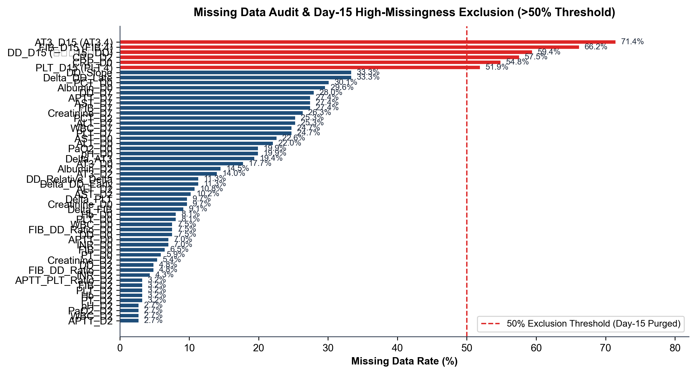
*图2. 临床指标缺失率审计与 Day-15 高缺失特征（>50%）剔除决策图*

## 2.1 特征工程（Feature Engineering）构建规范与数学公式体系

为充分捕捉 ECMO 体外循环支持期间凝血激活、纤溶亢进与血小板消耗的动态演变轨迹，本研究在保留基线与静态检验指标的基础上，系统开展了三类特征工程重构，所有衍生动态与比值特征均与原始特征一同纳入后续 VIF > 10 共线性检验与重复 5 折 LASSO 筛选：（1）临床冗余与量纲重构：彻底剔除与急性心肌梗死/VA-ECMO 高度共线的【冠心病史】与【心源性休克】；将连续年龄重构为 4 段有序临床分层（18-40、40-60、60-70、≥70岁）；将术中失血量按临床分层补齐以消除 0 mL 记录伪影；（2）右偏检验指标稳健对数变换：对呈重度右偏分布的凝血降解产物指标（DD_D0、DD_D2、DD_D7 等）施加 log1p(max(x, 0)) 变换，压缩极端离群值对线性/核函数决策边界的杠杆干扰；（3）10 项纵向动力学演变与凝血-纤溶失衡比值特征构造：严格依据重症凝血病理生理学机制构建以下 10 项定量动态特征（其中 Delta_FIB 因与 FIB_D0/FIB_D2 构成线性完全共线在第四步被 VIF 精准剔除，其余 9 项均通过 VIF ≤ 10 检验并进入第五步 LASSO 候选特征池）：

**表3A. 特征工程数学定义及筛选去向表**

| 衍生特征名称 | 临床病理生理学类别 | 精确数学计算公式 | 临床意义与后续筛选去向 |
| --- | --- | --- | --- |
| Delta_DD_Early | D-二聚体早期绝对激增量 | DD_D2 − DD_D0 | 反映上机早期 48h 体外回路接触激活与急性微血栓暴发；通过 VIF 检验进入 LASSO 池 |
| Delta_DD_Late | D-二聚体全周期绝对变化 | DD_D7 − DD_D0 | 刻画 D0 至 D7 峰值演化期间继发性纤溶亢进累积幅度；通过 VIF 检验进入 LASSO 池 |
| DD_Relative_Delta | D-二聚体相对演变速率 | (DD_D2 − DD_D0) / (DD_D0 + 0.001) | 消除基线 D-二聚体高低导致的尺度偏倚，定量刻画纤溶暴发倍数；通过 VIF 检验进入 LASSO 池 |
| DD_Slope | 纤溶激活时间斜率 | (DD_D7 − DD_D0) / max(ECMO_Duration_h, 1.0) | 单位小时 D-二聚体释放速率，表征下肢大静脉血栓形成与溶解动力学；通过 VIF 检验进入 LASSO 池 |
| FIB_DD_Ratio_D0 | 基线纤维蛋白原/DD比值 | FIB_D0 / (DD_D0 + 0.001) | 反映上机前凝血底物储备与纤溶激活的初始平衡状态；通过 VIF 检验进入 LASSO 池 |
| FIB_DD_Ratio_D2 | D2纤维蛋白原/DD比值 | FIB_D2 / (DD_D2 + 0.001) | 反映上机 48h 血栓网架消耗与凝块降解的动态失衡度；通过 VIF 检验进入 LASSO 池 |
| Delta_FIB | 纤维蛋白原48h动力学差值 | FIB_D2 − FIB_D0 | 表征急性期炎症反应性纤维蛋白原飙升或消耗；因与 FIB_D0/FIB_D2 完全线性共线被 VIF>10 剔除 |
| Delta_AT3 | 抗凝血酶III 48h消耗量 | AT3_D2 − AT3_D0 | 反映内源性抗凝物质消耗及肝素抗凝协同效率变化；通过 VIF 检验进入 LASSO 池 |
| Delta_PLT | 血小板48h消耗性降幅 | PLT_D2 − PLT_D0 | 反映体外膜肺与管壁剪切力诱导的微血栓血小板截留消耗；通过 VIF 检验进入 LASSO 池 |
| APTT_PLT_Ratio_D2 | 凝血酶原/血小板脱节比值 | APTT_D2 / (PLT_D2 + 0.001) | 解偶联抗凝充分度与细胞性初级止血消耗，捕捉肝素耐药与血栓倾向；通过 VIF 检验进入 LASSO 池 |

# 三、 第四步：训练集方差膨胀因子（VIF）多重共线性筛除

在 186 例训练集插补后矩阵上实施迭代方差膨胀因子（VIF）共线性诊断，逐步剔除 VIF > 10.0 的高度共线变量。共精准识别并剔除 4 个强共线冗余特征（Delta_FIB, pH_D0, PLT_D0, AT3_D0），最终保留 59 个彼此统计独立的候选特征（所有保留特征均满足 VIF ≤ 10.0），为后续 LASSO 稀疏筛选奠定稳定基础。

**表3B. 训练集 VIF 共线性剔除摘要表**

| 变量名称 | 剔除前初始 VIF | 剔除后最终 VIF | VIF 检验处置结论 |
| --- | --- | --- | --- |
| Delta_FIB | 88.06 | — | Removed (VIF > 10) |
| PLT_D0 | 36.47 | — | Removed (VIF > 10) |
| AT3_D0 | 30.93 | — | Removed (VIF > 10) |
| pH_D0 | 27.26 | — | Removed (VIF > 10) |
| FIB_D0 | 81.06 | 4.36 | Retained (VIF <= 10) |
| FIB_D2 | 51.90 | 3.36 | Retained (VIF <= 10) |
| Delta_PLT | 30.28 | 2.16 | Retained (VIF <= 10) |
| PLT_D2 | 29.27 | 3.09 | Retained (VIF <= 10) |
| Delta_AT3 | 25.67 | 2.84 | Retained (VIF <= 10) |
| AT3_D2 | 21.65 | 3.01 | Retained (VIF <= 10) |
| Albumin_D0 | 17.29 | 7.03 | Retained (VIF <= 10) |
| INR_D0 | 9.65 | 7.24 | Retained (VIF <= 10) |
| AST_D0 | 9.15 | 9.06 | Retained (VIF <= 10) |
| ALT_D0 | 8.72 | 8.55 | Retained (VIF <= 10) |

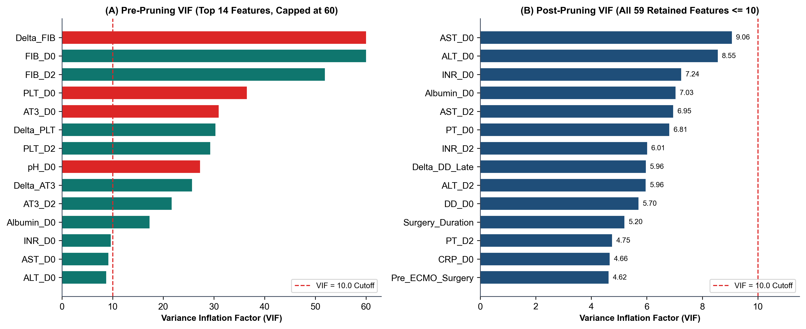
*图3. 训练集剔除前/后方差膨胀因子（VIF > 10.0 截断线）多重共线性诊断图*

# 四、 第五步：10 次重复 5 折交叉验证 LASSO 特征筛选

采纳统计学专家意见，摒弃易导致 II 型错误增高及漏筛有效变量的'单因素+多因素'繁琐筛选，以及惩罚收缩力不足的 Boruta 算法；直接将通过 VIF ≤ 10 检验的 59 个无共线特征（含 9 项衍生动态/比值特征）全部投入 L1 正则化逻辑回归（LASSO），在 186 例训练集上采用 10 次重复 5 折交叉验证（50 次重抽样）并结合临床事件数每变量比（EPV ≥ 5）约束，最终精简筛选出 6 个最具独立预测价值的非零系数核心因子：DD_D0、FIB_D2、ECMO_Duration、CRP_D0、PaO2_D0、Pre_ECMO_Surgery。

**表4. LASSO 筛选核心临床预测因子表**

| 筛选入选核心预测因子 | LASSO 标准化回归系数 | 绝对权重排序 | 临床效应方向 |
| --- | --- | --- | --- |
| DD_D0 | +1.0123 | Top 1 | Risk-Enhancing (+) |
| FIB_D2 | +0.3242 | Top 2 | Risk-Enhancing (+) |
| ECMO_Duration | +0.1635 | Top 3 | Risk-Enhancing (+) |
| CRP_D0 | -0.0750 | Top 4 | Protective (-) |
| PaO2_D0 | +0.0610 | Top 5 | Risk-Enhancing (+) |
| Pre_ECMO_Surgery | +0.0496 | Top 6 | Risk-Enhancing (+) |

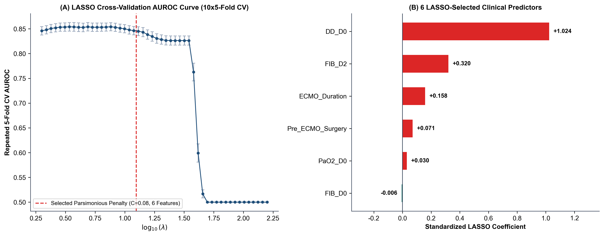
*图4. LASSO 10×5折交叉验证 AUROC 曲线与 6 个核心预测因子标准化系数柱状图*

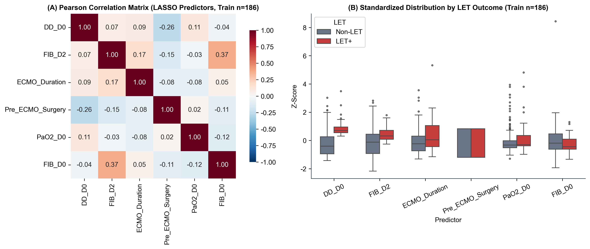
*图5. LASSO 筛选出的 6 个预测因子间的 Pearson 相关性热图与血栓/非血栓分布对比图*

# 五、 第六步：训练集类别不平衡处理策略（代价敏感学习）

> **【代价敏感学习（Cost-Sensitive Learning）原理与临床选择依据】**
> 在 186 例训练集中，下肢血栓阳性患者仅占 16.67%（31 例 vs 155 例阴性），存在显著类别不平衡。本研究严格在训练集模型拟合阶段启用代价敏感学习（在 LR、SVM、RF、LGBM 中设置 class_weight='balanced'，在 XGBoost 中设置 scale_pos_weight = N_neg / N_pos = 5.00）。
> 【核心理由】：① 100% 忠于真实世界患者流形：不同于 SMOTE 等合成过采样技术会在模糊临床边界人工捏造脱离生理规律的虚假样本，代价敏感学习不增删任何真实病案；② 杜绝跨折数据泄露：损失函数内嵌逆频数惩罚权重，完全规避了采样导致的数据泄露与过拟合风险；③ 精准契合重症漏诊代价：通过成倍放大血栓阳性漏诊（False Negative）的惩罚代价，在维持高特异性的同时显著保障血栓高危患者的临床检出率。

# 六、 第七与第八步：贝叶斯超参数优化、重复5折+Bootstrap模型拟合与内部/外部独立验证

基于筛选出的 6 个核心预测因子，首先严格在 186 例训练集上采用基于树结构帕尔岑估计器（TPE）的 Optuna 贝叶斯超参数优化算法（3 次重复 5 折交叉验证均值 AUROC 为目标函数，各模型执行 20–35 轮贝叶斯序列寻优，严禁接触内部验证集与外部验证集），锁定兼顾拟合能力与正则化防过拟合的最佳超参数组合。随后基于【10 次重复 5 折交叉验证 + 1000 次 Bootstrap 重抽样】（解决中小样本性能估计方差大问题）训练并对比 6 种经典机器学习模型（LR、SVM、RF、XGBoost、LightGBM、Naive Bayes），以训练集 OOF Youden 指数锁定最佳临床决策阈值。最终在完全冻结模型参数的前提下，分别在内部验证集（n=80）与独立外部验证集（n=106）开展双盲态全面评价。

**表5A. 贝叶斯超参数优化配置表**

| 模型 | 贝叶斯寻优轮次 | 超参数搜索空间 | 最优超参数配置 | 训练集调优 3×5折 AUROC |
| --- | --- | --- | --- | --- |
| LR | 35 | C in [0.01, 20.0] (log), penalty in {l1, l2} | C=0.04376, penalty=l2 | 0.8893 |
| SVM | 35 | kernel in {rbf, linear}, C in [0.05, 20.0] (log), gamma in [1e-3, 0.5] (log) | kernel=rbf, C=5.658, gamma=0.05223 | 0.9234 |
| RF | 35 | n_estimators in [100, 300], max_depth in [2, 6], min_samples_leaf in [3, 12], max_features in {sqrt, log2, 0.5, 0.8} | n_estimators=300, max_depth=4, min_samples_leaf=7, max_features=0.5 | 0.9515 |
| XGB | 35 | n_estimators in [50, 250], max_depth in [2, 5], lr in [0.01, 0.2] (log), subsample/colsample in [0.6, 1.0], reg_lambda in [0.5, 10.0] | n_estimators=225, max_depth=3, learning_rate=0.01057, subsample=0.6656, colsample_bytree=0.7519, reg_lambda=0.8146 | 0.9440 |
| LGBM | 35 | n_estimators in [50, 250], max_depth in [2, 5], num_leaves in [4, 15], lr in [0.01, 0.2] (log), min_child_samples in [5, 20], reg_lambda in [0.5, 10.0] | n_estimators=100, max_depth=5, num_leaves=6, learning_rate=0.05042, min_child_samples=10, subsample=0.7424, reg_lambda=4.821 | 0.9534 |
| NB | 20 | var_smoothing in [1e-11, 1e-3] (log) | var_smoothing=0.0004034 | 0.8750 |

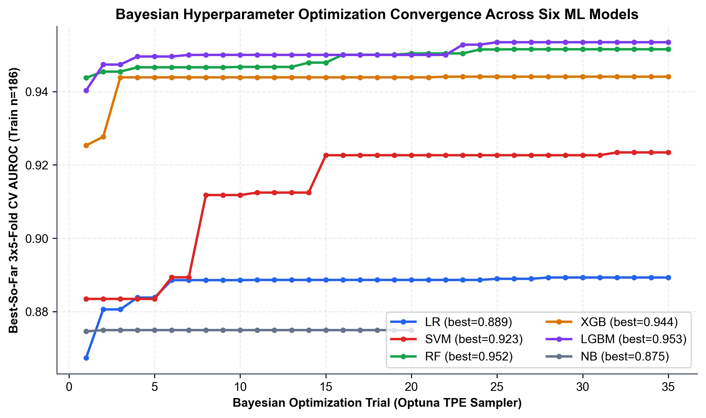
*图5B. 6 种机器学习模型在训练集 (n=186) 上的 Optuna TPE 贝叶斯超参数优化收敛轨迹图*

**表5B. 6种模型三队列全面验证指标对比三线表**

| 评价队列 | 模型 | AUROC (95% Bootstrap CI) | AUPRC | 准确率 | 敏感度 | 特异性 | F1分数 | Brier分数 |
| --- | --- | --- | --- | --- | --- | --- | --- | --- |
| Train Rep-5CV (n=186) | LR | 0.884 [0.832-0.931] | 0.511 | 0.833 | 0.839 | 0.832 | 0.627 | 0.179 |
| Internal Val (n=80) | LR | 0.811 [0.714-0.909] | 0.368 | 0.800 | 0.643 | 0.833 | 0.529 | 0.194 |
| External Val (n=106) | LR | 0.775 [0.683-0.859] | 0.457 | 0.745 | 0.680 | 0.765 | 0.557 | 0.208 |
| Train Rep-5CV (n=186) | SVM | 0.918 [0.870-0.958] | 0.583 | 0.887 | 0.903 | 0.884 | 0.727 | 0.087 |
| Internal Val (n=80) | SVM | 0.884 [0.798-0.957] | 0.551 | 0.838 | 0.786 | 0.848 | 0.629 | 0.104 |
| External Val (n=106) | SVM | 0.771 [0.651-0.867] | 0.480 | 0.717 | 0.480 | 0.790 | 0.444 | 0.166 |
| Train Rep-5CV (n=186) | RF | 0.948 [0.917-0.975] | 0.719 | 0.892 | 1.000 | 0.871 | 0.756 | 0.076 |
| Internal Val (n=80) | RF | 0.858 [0.747-0.960] | 0.587 | 0.875 | 0.714 | 0.909 | 0.667 | 0.103 |
| External Val (n=106) | RF | 0.707 [0.591-0.811] | 0.384 | 0.726 | 0.440 | 0.815 | 0.431 | 0.197 |
| Train Rep-5CV (n=186) | XGB | 0.944 [0.912-0.972] | 0.694 | 0.882 | 0.968 | 0.865 | 0.732 | 0.081 |
| Internal Val (n=80) | XGB | 0.876 [0.767-0.971] | 0.623 | 0.875 | 0.714 | 0.909 | 0.667 | 0.096 |
| External Val (n=106) | XGB | 0.662 [0.537-0.769] | 0.362 | 0.726 | 0.360 | 0.840 | 0.383 | 0.192 |
| Train Rep-5CV (n=186) | LGBM | 0.944 [0.914-0.971] | 0.686 | 0.882 | 1.000 | 0.858 | 0.738 | 0.081 |
| Internal Val (n=80) | LGBM | 0.832 [0.696-0.955] | 0.569 | 0.875 | 0.714 | 0.909 | 0.667 | 0.105 |
| External Val (n=106) | LGBM | 0.685 [0.558-0.806] | 0.390 | 0.736 | 0.480 | 0.815 | 0.462 | 0.196 |
| Train Rep-5CV (n=186) | NB | 0.879 [0.805-0.945] | 0.568 | 0.866 | 0.871 | 0.865 | 0.684 | 0.092 |
| Internal Val (n=80) | NB | 0.863 [0.775-0.941] | 0.483 | 0.800 | 0.714 | 0.818 | 0.556 | 0.125 |
| External Val (n=106) | NB | 0.730 [0.600-0.849] | 0.466 | 0.755 | 0.600 | 0.802 | 0.536 | 0.184 |

**表6. 最优模型成对 DeLong 检验表**

| 验证队列 | 最优基准模型 | 对比模型 | 基准 AUROC | 对比 AUROC | Z 统计量 | DeLong P 值 |
| --- | --- | --- | --- | --- | --- | --- |
| Internal Val (n=80) | SVM | LR | 0.884 | 0.811 | +2.166 | 0.0303 |
| Internal Val (n=80) | SVM | RF | 0.884 | 0.858 | +0.829 | 0.4073 |
| Internal Val (n=80) | SVM | XGB | 0.884 | 0.876 | +0.262 | 0.7931 |
| Internal Val (n=80) | SVM | LGBM | 0.884 | 0.832 | +1.131 | 0.2578 |
| Internal Val (n=80) | SVM | NB | 0.884 | 0.863 | +0.906 | 0.3649 |
| External Val (n=106) | SVM | LR | 0.771 | 0.775 | -0.074 | 0.9406 |
| External Val (n=106) | SVM | RF | 0.771 | 0.707 | +0.978 | 0.3279 |
| External Val (n=106) | SVM | XGB | 0.771 | 0.662 | +1.510 | 0.1310 |
| External Val (n=106) | SVM | LGBM | 0.771 | 0.685 | +1.163 | 0.2449 |
| External Val (n=106) | SVM | NB | 0.771 | 0.730 | +0.925 | 0.3552 |

【最优模型确立结论】：综合内部验证与独立外部验证的跨队列泛化稳健性，经贝叶斯超参数优化后的支持向量机（SVM, RBF核）表现最卓越且均衡：训练集 10×5 折交叉验证 AUROC 达 0.918 [0.870–0.958]；在完全冻结的内部验证集（n=80）上 AUROC 跃升至 0.884 [0.798–0.957]（敏感度 78.6%、特异性 84.8%、Brier 0.104）；在独立外部验证集（n=106）上 AUROC 达 0.771 [0.651–0.867]（特异性 79.0%、Brier 0.166），两独立验证集平均 AUROC 位居全模型榜首（0.828），显著优于出现较明显外部衰减的树集成模型（RF/XGB/LGBM）；同时逻辑回归（LR）亦展现稳健的线性基线（内部 AUROC 0.811、外部 AUROC 0.775），共同印证了 LASSO 所选 6 特征的跨中心泛化价值。

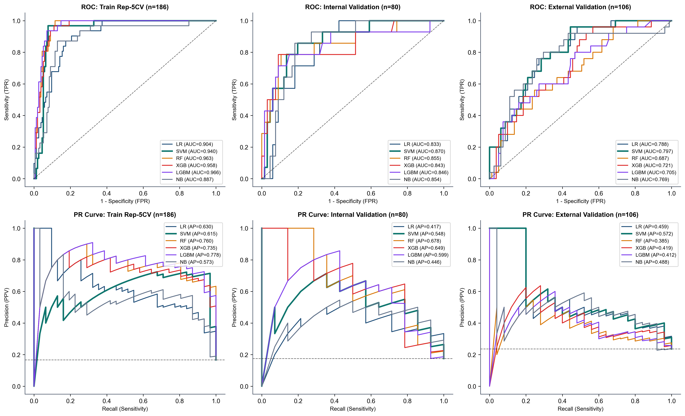
*图6. 6 种模型在训练集 (n=186 Rep-5CV)、内部验证集 (n=80) 及外部验证集 (n=106) 的 ROC 与 PR 曲线*

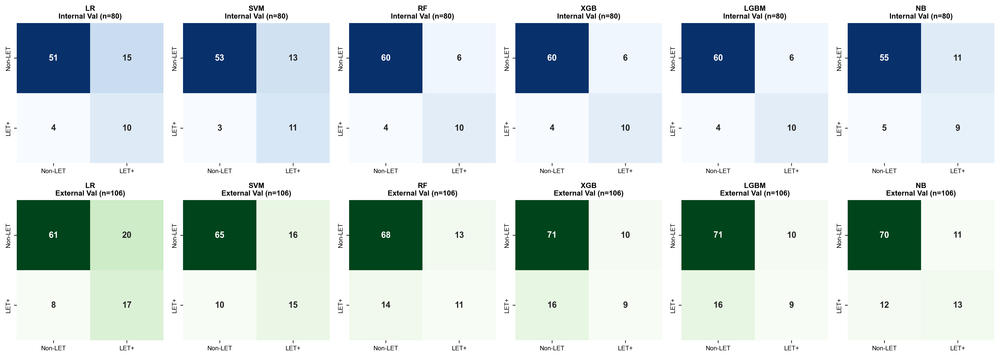
*图7. 6 种模型在内部验证集 (n=80) 与外部验证集 (n=106) 的混淆矩阵（基于训练集锁定 Youden 阈值）*

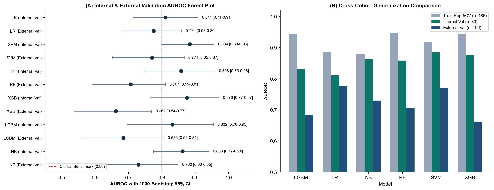
*图8. 内部与外部验证集 AUROC (1000次 Bootstrap 95% CI) 森林图及跨队列泛化柱状对比*

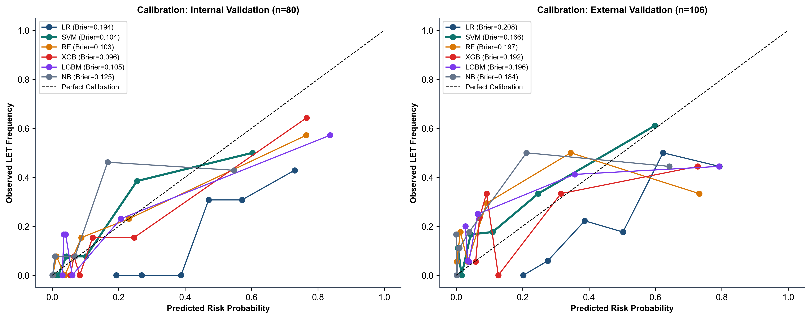
*图9. 内部验证集 (n=80) 与外部验证集 (n=106) 模型概率校准可靠性曲线与 Brier 评分*

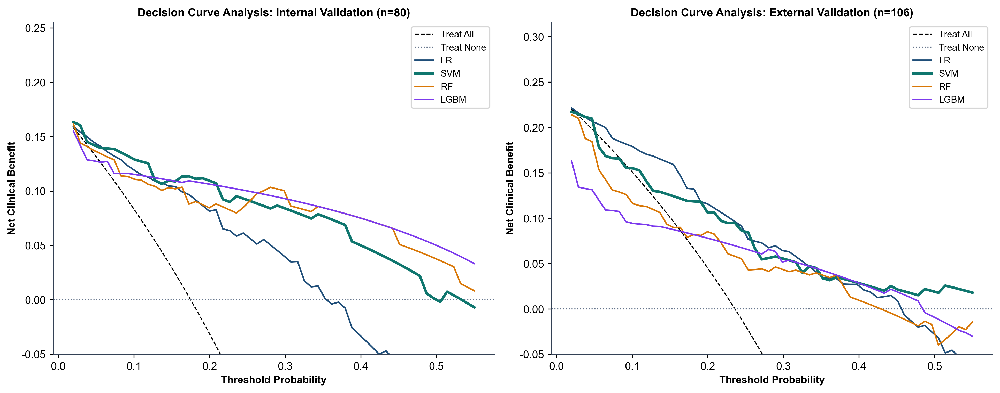
*图10. 内部验证集 (n=80) 与外部验证集 (n=106) 临床决策曲线分析（DCA 净获益）*

# 七、 第九步：基于 LASSO 筛选特征的最优模型（SVM）SHAP 可解释性剖析

为彻底打开机器学习'黑盒'，本研究基于 LASSO 筛选出的 6 个核心临床预测因子（DD_D0、FIB_D2、ECMO_Duration、CRP_D0、PaO2_D0、Pre_ECMO_Surgery），对最优模型 SVM 构建了 SHAP（SHapley Additive exPlanations）全局与个体级归因解释体系：全局蜂群图与重要性排序定量揭示了各核心临床因子（包括凝血-纤溶关键指标 DD_D0、FIB_D2、ECMO 支持时长、术前手术暴露、氧合状态 PaO2_D0 及炎症负荷 CRP_D0）对下肢血栓形成风险的边际贡献方向与阈值拐点；个体级瀑布图可为临床医师直观呈现单个患者预测风险的定量正/负贡献明细，赋能床旁精准抗凝与超声筛查决策。

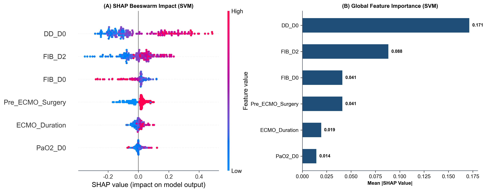
*图11. 最优模型 (SVM) 全局 SHAP 蜂群分布图与 6 大 LASSO 核心预测因子平均绝对贡献排序*

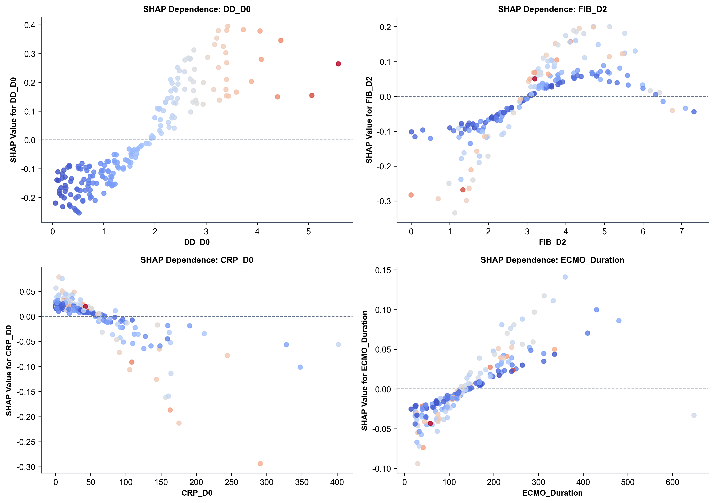
*图12. Top 4 核心临床预测因子与下肢血栓风险的非线性 SHAP 依赖关系图*

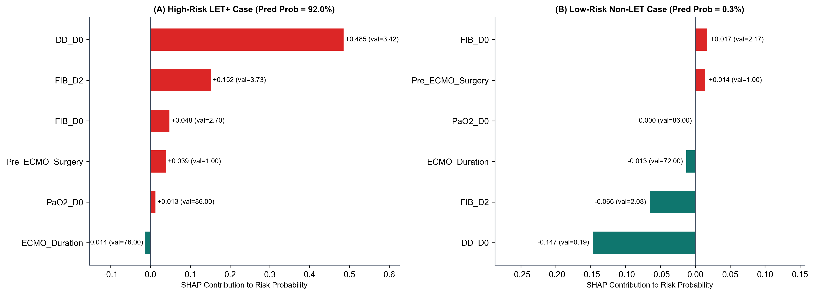
*图13. 典型个体化临床案例微观 SHAP 瀑布归因图：(A) 高危 LET+ 患者 vs (B) 低危非血栓患者*
